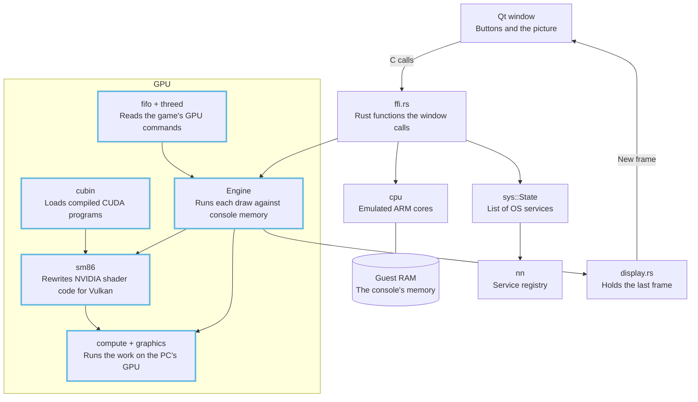

# Architecture

The emulator is made of a Qt window, an emulated ARM CPU, a registry of the Switch's operating system services, and a GPU emulator. The GPU part is the furthest along, and the CPU, service and audio parts are being built out. For example, the Triangle button writes GPU commands into the emulated console's memory, and the GPU part draws them on the PC's graphics card.

*The whole emulator. Blue outlines mark the GPU work.*

"Guest" in these pages means the emulated Switch 2, and "host" means the PC running oboromi.

## Which page answers what?

| Page | Question it answers |
|---|---|
| [Emulator overview](oboromi-overview.md) | What upstream built, and what each part does today |
| [CPU and shared memory](cpu.md) | How the cores run ARM code, share memory with the GPU, and what the kernel layer adds |
| [Services](services.md) | How a game reaches a service, and which services are being built |
| [Audio](audio.md) | How the audio renderer works, and the planned audio demos |
| [Guest path](guest-path.md) | How our own guest program will drive the GPU through real system calls |
| [GPU pipeline](gpu-pipeline.md) | How a game's draw command becomes pixels, and which branch holds what |
| [SASS translator](sass-translator.md) | How NVIDIA shader machine code becomes a Vulkan shader |
| [Vulkan backend](vulkan-backend.md) | How oboromi drives the PC's graphics card, and how it stays fast |
| [Command processor and memory](command-processor-and-memory.md) | How GPU commands are read, and how copies of memory stay correct |
| [Textures and tensors](textures-and-tensors.md) | How game images are decoded, and how matrix instructions are made exact |
| [Verification](verification.md) | How each instruction is proven against a real chip |
| [CUDA](cuda.md) | How compiled NVIDIA compute programs run as test programs |
| [Demos](demos.md) | What the window draws today, and the scenes planned next |
| [Roadmap](roadmap.md) | What is done, what is in progress, and the honest limits |
| [Glossary](../glossary.md) | Every term, in one plain sentence plus an example |

## Where are the design choices explained?

Each big choice has a decision record (ADR): the problem, the choice, and what it costs. Every record opens with a short "In plain words" section. They are listed under [decision records](../adr/README.md).

## Where should I start?

New to the code: read the overview, then the GPU pipeline, then the page for the part you are touching. Reviewing a GPU pull request: read the GPU pipeline for the branch map, then verification for what has to pass.

Verified by: every page names its own checks in a "Verified by" line.

Sources: core/src/lib.rs, core/src/gpu/mod.rs, gui-qt/src/MainWindow.cpp, README.md.
