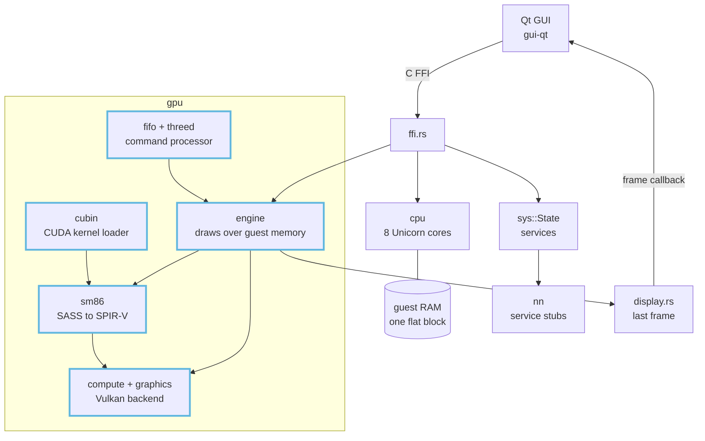

# Architecture

oboromi emulates the Nintendo Switch 2. The CPU side runs ARM code on Unicorn over one flat RAM block, the firmware services are named stubs, and nothing loads a game yet. The GPU side is the part with real depth: it reads guest pushbuffers, translates the guest's SM86 shader machine code (SASS) to SPIR-V and runs it on any Vulkan device.

The blue-outlined boxes are the GPU work these pages describe. Everything else is context.

## The pages

| page | what it answers |
|---|---|
| [oboromi overview](oboromi-overview.md) | what the rest of the emulator does today, and what is stub |
| [GPU pipeline](gpu-pipeline.md) | the path from a guest pushbuffer to pixels, and which branch holds what |
| [SASS translator](sass-translator.md) | how SM86 machine code becomes SPIR-V |
| [Vulkan backend](vulkan-backend.md) | device, pipelines, buffers, images and the latency rules |
| [Command processor and memory](command-processor-and-memory.md) | GPFIFO, the 3D and compute classes, the page map and coherence |
| [Textures and tensors](textures-and-tensors.md) | TIC/TSC decode, texture layouts, the tensor core model |
| [Verification](verification.md) | the four test tiers and the bugs each one caught |
| [CUDA](cuda.md) | running compiled CUDA kernels on the translator and natively |
| [Demos](demos.md) | what the window can draw today and the planned scenes |
| [Roadmap](roadmap.md) | open items by area, and the honest limits |
| [Glossary](../glossary.md) | SASS, SPIR-V, GPFIFO, TIC/TSC, QMD, SPH, cbuf and friends |

## Decisions

The choices that shaped the GPU work are recorded as ADRs under [docs/adr](../adr/README.md): one page each, with the problem, the decision and what it costs.

## Reading order

New to the code: overview, then GPU pipeline, then the subsystem you are touching. Reviewing a GPU PR: GPU pipeline for the branch map, then verification for what has to pass.

Verified by: every page names its own checks in a "Verified by" line.

Sources: core/src/lib.rs, core/src/gpu/mod.rs, gui-qt/src/MainWindow.cpp, README.md.
