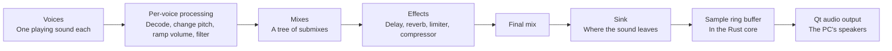

# Audio

A Switch game makes sound by describing it to the audio renderer service, not by writing samples to a speaker. It lists its sounds, their volumes, their effects and where the result goes. The service then mixes them in small steps. For example, a game plays footsteps by adding a voice that points at a footstep sample, with a volume and a reverb send.

*How the renderer turns a game's voices into sound on the PC.*

## How does a game use the audio renderer?

The renderer service is `audren`. The service registry already has its entry, and this design fills it in.

1. The game fills in its settings: sample rate, frame size, how many voices, mixes, effects and sinks it wants, and a revision number.
2. It asks the service how large a work buffer that needs, then hands over that memory.
3. It opens the renderer and starts it.
4. Every step, it sends an update with the state of all its voices, mixes, effects and sinks. The service answers with their new state.

| Renderer fact | Value |
|---|---|
| Sample rate | 48 kHz |
| Frames per step | 240 |
| Step length | 5 ms |
| Work buffer | Guest memory the game hands over, mapped, not copied |
| Output samples | Signed 16-bit, interleaved per frame |

Rendering runs on its own clock, one step every 5 ms, and never follows the screen's frame rate.

## What are voices, mixes, effects and sinks?

| Part | What it is | Example |
|---|---|---|
| Voice | One playing sound: sample data plus pitch, volume and filters | A footstep |
| Wave buffer | A piece of sample data a voice plays, in PCM16, float or ADPCM, a compressed format | The footstep's samples |
| Biquad filter | A small filter that cuts or boosts some frequencies | A low-pass to muffle a sound behind a wall |
| Mix | A bus that voices or other mixes add into | "All sound effects" |
| Splitter | Sends one voice to several mixes with different volumes | Dry sound plus a reverb send |
| Effect | Processing on a mix | Reverb, delay, limiter, compressor |
| Sink | Where the final sound goes | The device sink, the speakers |
| De-pop | Smooths a sudden volume change so it does not click | A voice that stops mid-sample |

In the design, the device sink hands interleaved signed samples to the host, in the format the table below gives. The Rust core will keep them in a ring buffer that the C interface exposes, like the frame slot for the display. The Qt window will play them through Qt's own audio output, so the Rust core needs no audio library. If the buffer runs dry, the output plays silence and never blocks the window.

`audout` is the simpler raw-output service: a game queues buffers of finished samples, and the service plays them in order.

## Which revisions are there?

Each game says which renderer revision it was built for, and newer revisions add features.

| Revision | Adds |
|---|---|
| 1 | The first renderer |
| 2 | Splitters, a fix to ADPCM looping |
| 3 | Longer reverb pre-delay |
| 4 | USB output, a higher processing limit |
| 5 | Voice decode and flush, performance metrics version 2 |
| 6 | A biquad state fix |
| 7 | Mix updates only when they change |
| 8 | Wave buffer loop control, resampler quality settings, float samples |
| 9 | Effect info version 2, the limiter |
| 10 | Bluetooth output, capture, a second biquad per voice |
| 11 | New delay and reverb parameters, compressor, voice drop |
| 12 | Filter and mix fused into one step, filters on splitters |
| 13 | Compressor statistics, explicit splitter volume reset |

On the Switch 2, the renderer accepts a revision marker only the Switch 2 uses. Its work buffer also grew in the 19.x and 20.x system updates. The table above follows the Switch 1 references, so the newest Switch 2 revision is not assumed to be 13 until firmware evidence shows it.

## How is it built and checked?

The implementation follows switchbrew's documentation, with the Ryujinx and yuzu emulators as behaviour references only: their code is not copied. Tests use our own fixtures: ADPCM decoding, resampler responses, reverb tails, volume ramps and the final sample format, checked at every step.

| Step | State |
|---|---|
| Research and design | Done |
| Update parsing, PCM16 voices and the device sink | Planned, next on the `audio` branch |
| Mixes and volume ramps | Planned |
| ADPCM, resampling, biquads and de-pop | Planned |
| Effects, splitters, revision gates | Planned |
| `audout` and the demos | Planned |

## Which demos are planned?

Like the GPU demos, the host plays the game's part until the [guest path](guest-path.md) can run a real program.

| Demo | What it shows |
|---|---|
| Music | Music voices in PCM and ADPCM, pitch changes, delay and reverb |
| Collisions | A GPU compute physics step reports collisions, and each one plays a short sound, louder for harder hits |
| The BoomBox room | A first-person room with the BoomBox model as a sound source. Distance sets volume and panning. GPU ray queries check whether walls block the sound and pick a muffling filter. Room zones pick the reverb. |

In the room demo, occlusion and position are game work: the game computes them and sets ordinary voice volumes and filters. The renderer itself has no 3D audio, just as on the real console.

Verified by: nothing yet, as no audio code has landed; this page records the design.

Sources: switchbrew's Audio services page, Ryujinx's Ryujinx.Audio renderer and yuzu's audio_core as behaviour references.
