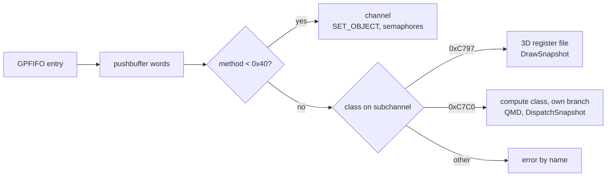

# Command processor and memory

The command processor reads GPFIFO entries, splits pushbuffers into method writes and routes each write to the class bound on its subchannel. Guest memory sits behind a GPU page map, and the guest's own RAM stays the one copy every host resource is checked against.

## GPFIFO and method headers

| item | bits | meaning |
|---|---|---|
| entry word 0 | 31:2 | pushbuffer address, low part |
| entry word 1 | 7:0, 9, 30:10, 31 | address high byte, level, length in words, sync |
| header | 11:0 | method, as a word index |
| header | 15:13 | subchannel |
| header | 28:16 | count, or the value for immediate mode |
| header | 31:29 | mode: 1 incrementing, 3 non-incrementing, 4 immediate, 5 increment once, 7 end of segment |

Methods below 0x40 belong to the channel: `SET_OBJECT` binds a class id to the subchannel, `SEMAPHORE_A` to `D` produce acquire and release events. Anything else goes to the bound class, and an unbound subchannel or unknown class is an error.

## The 3D class, 0xC797

`ThreeD` keeps the raw register words plus dirty groups (vertex streams, attributes, colour targets, viewport and scissor, shader programs, cbuf binds, blend and depth, index buffer). At a draw trigger it emits a `DrawSnapshot`: topology, counts, vertex streams and attributes, the six shader program slots, colour target 0, viewport, scissor, write mask, depth, cull, blend flags, the index buffer and the bound cbufs per binding group. `LOAD_CONSTANT_BUFFER` is an ordered event too, so cbuf updates between draws land in order.

## The compute class, 0xC7C0

On `gpu/qmd-dispatch`: writing `SEND_SIGNALING_PCAS_B` fetches the 256-byte QMD at `SEND_PCAS_A` and decodes QMDV02_03 into a `DispatchSnapshot`: program address, grid, block, shared size, eight cbufs, two release semaphores, barrier and register counts, shared and local windows, sampler and texture pools. Other QMD versions are rejected.

## Page map and coherence

`PageMap` maps GPU VA pages to guest-physical pages, one map per address space, in 64 KiB pages (the big page size Ryujinx maps with; the T239 value is unverified). Unmapped ranges are errors, never a guess. `MemoryTracker` stamps every write to a physical page with a global generation and its writer, CPU or GPU.

| resource | keyed by | refreshed when |
|---|---|---|
| buffer mirror (vertices, cbufs) | guest-physical ranges | the ranges' generation moved |
| render target | ranges, format, size, depth | always written back after the draw |
| shader module | hash of SPH and code | never, the key is the content |

The rule: guest memory is the authority. Every GPU result is written back before `submit` returns, and a colour target whose pages changed outside its own draws is an error until loading is implemented, never a stale image. Remapping a VA to other pages changes what the next draw reads.

Why: identity by physical page survives remaps and aliasing, and nothing can show a frame the guest's memory does not hold. See [ADR-0004](../adr/0004-backing-memory-authority-for-coherence.md).

## Deferred

| item | why it waits |
|---|---|
| MME64 macros | no Ampere header; the only public MME64 docs are Turing's |
| syncpoint and channel ioctls, nvdrv, nvmap, address-space ioctls | no loader or guest issues them yet |
| semaphore acquire | errors by name in the engine |
| 2D, DMA and inline-to-memory classes | not needed by the first scenes |

Verified by: `core/src/tests/gpu/fifo.rs` and `memory_map.rs`, the engine acceptance test (draw, report, VA remap), and the QMD tests on its branch.

Sources: core/src/gpu/{fifo,threed,memory,engine}.rs, core/src/gpu/compute_class.rs on gpu/qmd-dispatch, clc76f.h, clc797.h and clc7c0qmd.h field notes in the design note "graphics codebase", project notes on the graphics plan.
