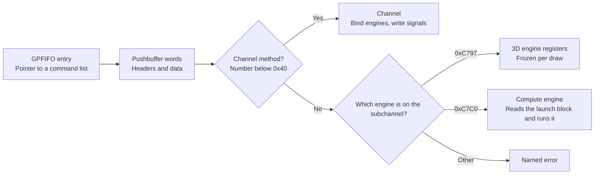

# Command processor and memory

The command processor is the GPU's front desk: it reads the command lists a game writes and hands each command to the right engine. Memory follows one rule: the emulated console RAM holds the only real copy of anything. For example, if a game moves a vertex buffer, the next draw reads the new place, because every copy is checked against RAM.

## What does a command look like?

A game puts commands in a pushbuffer, a list of 32-bit words in guest memory. It then adds an entry to the GPFIFO, a ring of pointers to those lists. Each command starts with a header word saying which register to write, on which engine, and how many data words follow.

| Item | Bits | Meaning |
|---|---|---|
| GPFIFO entry word 0 | 31:2 | Pushbuffer address, low part |
| GPFIFO entry word 1 | 7:0, 9, 30:10, 31 | Address high byte, level, length in words, sync |
| Header | 11:0 | Method, the register to write, as a word index |
| Header | 15:13 | Subchannel, the slot that picks the engine |
| Header | 28:16 | How many data words follow, or the value itself in immediate mode |
| Header | 31:29 | Mode: 1 incrementing, 3 non-incrementing, 4 immediate, 5 increment once, 7 end of segment |

Low method numbers belong to the channel, the command stream itself. Its `SET_OBJECT` binds an engine, a class, to a subchannel, and its `SEMAPHORE_A` to `D` methods write "got this far" signals. Every other method goes to the class bound on the header's subchannel. An empty subchannel or an unknown class is an error.

*How one command word finds the engine it is meant for.*

## What does the 3D engine keep?

The 3D class, 0xC797, is the drawing engine. `ThreeD` keeps its raw register words and notes which groups changed: vertex streams, attributes, colour targets, viewport and scissor, shaders, constant buffer bindings, blend and depth, and the index buffer.

At each draw it freezes a `DrawSnapshot`, a copy of everything the draw needs. That covers the triangle type, counts and instances, vertex streams and attributes, and every shader slot. It also holds the first colour target, the depth target, viewport, scissor, write mask, culling and blending. The index buffer, the bound constant buffers and the texture and sampler pools are in it too.

Two more things happen at a draw:

- A draw framed by `BEGIN` that continues the previous one with the next instances merges into one instanced draw. Instancing means drawing the same mesh many times in one call.
- The window origin setting says whether screen y counts up from the bottom row, and whether triangles flip which side faces forward. The snapshot carries both, and the engine flips the picture to match.

A constant buffer, or cbuf, is a small read-only table the game hands a shader, such as the camera matrix. `LOAD_CONSTANT_BUFFER` updates one, and it is an ordered event too. So a cbuf changed between draws reaches the right draw.

## How is a compute launch read?

The compute class, 0xC7C0, starts compute work. A launch is described by a QMD, a fixed-size block in guest memory. Writing `SEND_SIGNALING_PCAS_B` makes the class fetch the QMD at `SEND_PCAS_A` and decode it into a `DispatchSnapshot`. The engine then runs it, see the [GPU pipeline](gpu-pipeline.md).

| QMD field group | What it holds |
|---|---|
| Program | The shader's address |
| Grid and block | How many thread groups, and how many threads per group |
| Memory | Shared memory size, shared and local memory windows |
| Constant buffers | Eight cbuf bindings |
| Signals | Two release semaphores |
| Limits | Barrier and register counts |
| Textures | The sampler and texture pools |
| Version | QMDV02_03 and QMDV03_00; others are rejected |

## How do GPU addresses become memory?

Shaders use GPU virtual addresses (VA), which the game can point anywhere. `PageMap` turns them into guest-physical addresses (PA), the place in emulated RAM where the bytes really sit. There is one map per GPU address space, and an address outside it is an error, never a guess.

`MemoryTracker` stamps every write to a physical page with a global counter, the generation, and who wrote it, CPU or GPU. A host copy compares that counter with the one it was made from, so it knows when it is stale.

| Fact | Value |
|---|---|
| Page size | 64 KiB, the big page size Ryujinx uses; the T239 value is unverified |
| Map scope | One per GPU address space |

| Host copy | Keyed by | Refreshed when |
|---|---|---|
| Buffer mirror: vertices, cbufs | Guest-physical ranges | The ranges' generation moved |
| Render target, the image a draw paints | Ranges, format, size, depth | Loaded before a draw when its pages changed elsewhere, always written back after |
| Texture | Ranges, texture header, sampler entry | The ranges' generation moved |
| Depth target | The draw's depth address | Kept on the host only; it must be cleared before its first draw |
| Translated shader | Hash of shader header and code | Never, the key is the content |

The rule: guest memory is the authority. Every GPU result is written back before `submit` returns. A colour target whose pages changed outside its own draws is loaded from guest memory before the next draw. A clear that no draw uses is written into guest memory, where the next draw loads it. So drawing into an image and then sampling it as a texture shows the latest draw. Repointing a VA changes what the next draw reads.

Why: keying by physical page stays right when memory is remapped or shared. And nothing can show a frame the guest's memory does not hold. See [ADR-0004](../adr/0004-backing-memory-authority-for-coherence.md).

## What do semaphores and reports write?

A semaphore release writes a value to memory, so the CPU can see how far the GPU got. A report is the same kind of write, asked for by the 3D class. An acquire is the other side: it waits until a memory word reaches a value.

| Command | What lands in guest memory |
|---|---|
| Semaphore release | One 32-bit word |
| Short report | One 32-bit word |
| Full report | The 64-bit value and a 64-bit timestamp in nanoseconds |
| Acquire | Nothing; it is checked against the word in memory |

Commands run one after another here, so nothing else could release a waiting acquire. An acquire is therefore checked at once, and one that is not already met is a named error.

## What is still missing, and why?

| Item | Why it waits |
|---|---|
| MME64 macros, the GPU's built-in macro processor | No Ampere header exists; the only public MME64 docs are Turing's |
| Syncpoint and channel calls, nvdrv, nvmap, address-space calls | They arrive with the [guest path](guest-path.md) |
| 2D, DMA and inline-to-memory classes | The first scenes do not need them |

Verified by: `core/src/tests/gpu/fifo.rs`, `memory_map.rs` and `qmd.rs`, and the engine tests in `engine.rs` (draws, render to texture, clears, reports, acquires, VA remap).

Sources: core/src/gpu/{fifo,threed,memory,engine}.rs, core/src/gpu/compute_class.rs, NVIDIA's clc76f.h, clc797.h and clc7c0qmd.h.
