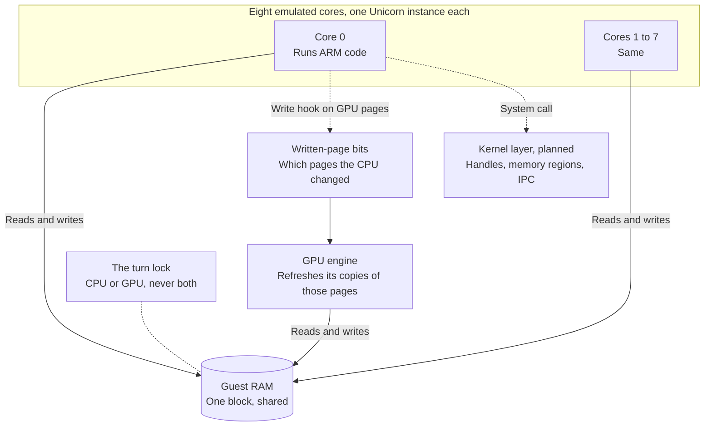

# CPU and shared memory

The CPU side runs the game's ARM code on eight emulated cores that all see one block of memory. The GPU now reads and writes that same block, so a value a core stores is what the next draw reads. For example, a core writes three vertices into memory, the GPU draws the triangle, and the core then reads back the report the GPU wrote.

*How the cores, the GPU and the planned kernel layer share one memory block.*

## What runs the ARM code?

Unicorn is a CPU emulator library built on the CPU core of QEMU, the open-source machine emulator. Upstream built the CPU manager on it: each core is its own Unicorn instance, and every core maps the same RAM block at guest address 0. A guest address is therefore also the offset into that block.

| CPU fact | Value |
|---|---|
| Cores | 8 |
| Guest RAM | 12 GiB, one block at guest address 0 |
| Address policy | Guest virtual address equals physical address, no MMU yet |
| Stack per core | Starts at the top of RAM, 1 MiB lower per core |
| Instruction set | AArch64, the 64-bit ARM set |

## How do the CPU and the GPU share memory?

This work is on the `guest-path` branch. The RAM block is one anonymous memory mapping, `GuestRam`, that the cores and the GPU both use. Two rules keep them in agreement:

- **One at a time.** A lock called the turn is held while a core runs and while the GPU runs. So the CPU and the GPU never touch the memory at the same moment.
- **The GPU knows what the CPU changed.** When the GPU maps a range, every core adds a Unicorn write hook on it. A write hook is a callback that runs on each store to that range, and it sets a bit for the page. Before the GPU runs, it takes those bits and refreshes its copies of exactly those pages.

The GPU's own results go straight into the block before the CPU gets its turn back. So a core always reads what the GPU last wrote.

| Coherence fact | Value |
|---|---|
| Tracking unit | One page of the GPU page map |
| Hooks per core | One per GPU-mapped range |
| Host writes, such as the test harness | Marked as CPU writes explicitly |

## What will the kernel layer add?

A game asks the operating system for things with a system call, an `SVC` instruction. The kernel layer, planned in `core/src/kernel`, catches these calls and answers them.

| Piece | What it does | State |
|---|---|---|
| System-call interception | A Unicorn interrupt hook stops the core at `SVC`, reads the arguments from registers x0 to x7, and resumes with the result | Planned |
| Handle table | Numbers the guest uses to name sessions, ports, events and transfer memory | Planned |
| Memory regions | Fixed code, stack, heap and transfer-memory ranges, with their bookkeeping | Planned |
| IPC | Messages from the guest to a service, see [services](services.md) | Planned |
| Scope | One process and one thread first; threads and scheduling come later | Decided |

Calls that are not implemented return an error, never a silent success.

## What is known about the Switch 2's CPU?

The Switch 2's chip, the T239, has eight Arm Cortex-A78C cores. The table marks where each fact comes from: **SB** means documented by switchbrew, the community's Switch wiki, and **INF** means inferred from Arm's documentation of the core.

| Fact | Source |
|---|---|
| Eight 64-bit Cortex-A78C cores | SB |
| 64 KiB instruction and data L1 cache, 256 KiB L2 per core, 4 MiB shared L3 | SB |
| Armv8.2-A instruction set with Neon and floating point | SB |
| LSE atomics, such as `CAS` and `LDADD` | INF |
| Half-precision float arithmetic | INF |
| Dot-product instructions `SDOT` and `UDOT` | INF |
| Crypto instructions exposed to games | Unknown, needs a Switch 2 capture |
| SVE vector instructions | Not expected, INF |
| Pointer authentication at user level | Unknown, needs a Switch 2 capture |

| Switch 2 kernel addition | Source |
|---|---|
| New calls 0x80 to 0x82 for GPU memory attributes and sharing | SB |
| Two new memory attribute bits, GPU-sharable and GPU-shared | SB |
| An error from a sync request closes the session | SB |

## How will this be validated?

Each fact gets one of four kinds of evidence, from cheapest to strongest:

| Evidence | Meaning |
|---|---|
| Doc | A test asserts the documented value |
| Arm differential | The same code runs under Unicorn and on a real Armv8.2 machine, such as a Raspberry Pi 5 or an AWS Graviton, and the results must match |
| Homebrew | A test program runs on a real console |
| Switch 2 capture | A recording from a real Switch 2 |

Passing on a Raspberry Pi 5 shows Armv8.2 behaviour, not Switch 2 behaviour. A mismatch with a documented value blocks the Switch 2 profile, and anything needing a capture stays marked as unverified.

Verified by: on the `guest-path` branch, `a_core_stores_the_vertices_the_gpu_draws_and_loads_the_report_the_gpu_wrote` and `a_second_frame_draws_the_vertices_a_core_stored_after_the_first`; on every branch, the CPU self-tests in `core/src/tests/run.rs` and `multicore_test.rs`.

Sources: core/src/cpu/{cpu_manager,unicorn_interface}.rs, core/src/cpu/guest_ram.rs on guest-path, core/src/tests/gpu/engine.rs on guest-path, switchbrew pages on the T239, SVC and memory layout, Arm's Cortex-A78C documentation.
