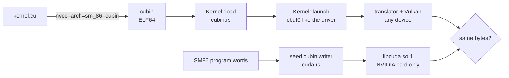

# CUDA

The Switch 2's GPU runs the same SM86 machine code a desktop Ampere card runs, so CUDA kernels compiled with `nvcc -arch=sm_86` are real guest-shaped programs. oboromi runs them two ways: through the translator on any Vulkan device, and natively on an NVIDIA card through libcuda.

## The cubin runner

`Kernel::load` reads the ELF sections `.text.<kernel>`, `.nv.info.<kernel>`, `.nv.constant<bank>` and `.nv.shared.<kernel>`, takes the SM number from `e_flags`, accepts sm_80 to sm_89 only, and finds the parameter area from `EIATTR_PARAM_CBANK` and `EIATTR_KPARAM_INFO`. `Kernel::launch` fills constant bank 0 the way the CUDA driver does:

| cbuf0 offset | holds | note |
|---|---|---|
| 0x0 | block dimensions | ntid x, y, z |
| 0xc | grid dimensions | nctaid x, y, z |
| 0x28 | initial stack pointer for R1 | silicon gives a driver address; here the top of the translator's local array |
| 0x118 | memory descriptor | zero on silicon, zero here |
| 0x160 on | kernel parameters | offsets and sizes from KPARAM_INFO |

Why this ABI: it was captured from the driver on silicon, so a cubin compiled today runs without patching.

## The native path

`cuda.rs`, behind the `cuda` feature, wraps a guest SM86 program in a cubin derived from a small seed kernel: it replaces `.text`, the parameter area, the shared size, the instruction offsets and the metadata, and keeps the seed's ELF header and segments. It opens `libcuda.so.1` at run time with no new crate, then `cuInit`, context, `cuModuleLoadData`, `cuLaunchKernel`, synchronize. `CudaDevice::run_native` copies buffers in and out.

When it applies: a host with an NVIDIA card that loads sm_86 cubins and its driver, running compute programs. The translator stays the reference and the portable path; the native tests check both give the same bytes. Graphics stages do not go native.

## Kernels that run

| kernel | source | result |
|---|---|---|
| mul-add `c[i] = a[i] * b[i] + i` | core/tests/fixtures/kernels.cu | bit for bit equal to the RTX 3090 capture |
| gradient | core/tests/fixtures/kernels.cu | same hash as on silicon |
| Mandelbrot0, float | NVIDIA cuda-samples, BSD-3 | correct image, see below |

measured, p50 per launch:

| run | device | time |
|---|---|---|
| Mandelbrot 800x600 on the translator | Intel Arc (MTL) | 10.2 ms |
| gradient 1080p on the translator | Intel Arc (MTL) | 3.4 ms |
| mul-add, native, copies included | RTX A6000 | 1.0 ms |
| gradient, native, copies included | RTX A6000 | 6.8 ms |
| Mandelbrot pixels equal to the sample's reference image | | 92.7 % |

The Mandelbrot reference image's provenance is unknown, so that last row is a sanity check, not a pass mark.

Planned next, in order: nbody and particles, simpleTexture, Sobel, box and bilateral filters, fluids and smoke, marching cubes.

Verified by: `cubin_kernels_match_silicon` on Intel and lavapipe, and `native_mul_add_matches_translator` and `native_gradient_matches_translator` on the RTX A6000 (they skip without libcuda).

Sources: core/src/gpu/cubin.rs and core/src/gpu/cuda.rs on gpu-instructions, core/src/tests/gpu/cuda.rs, core/tests/fixtures/kernels.cu and cuda-seed.cu.
