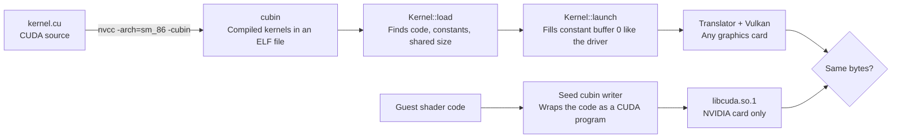

# CUDA

CUDA is NVIDIA's way of writing general programs for its GPUs. The Switch 2 runs the same machine code as a desktop Ampere card, so CUDA programs compiled for that card make good real-world test programs. For example, NVIDIA's Mandelbrot sample runs through the translator and draws the right picture.

The emulator runs compiled CUDA programs through the translator, on any Vulkan device. It can also run them natively on an NVIDIA card through libcuda, NVIDIA's driver library.

*Both ways a compiled CUDA program runs, and the byte comparison between them.*

## How does the cubin runner work?

A kernel is one CUDA program, and a cubin is the ELF file nvcc, NVIDIA's compiler, puts it in. `Kernel::load` reads the kernel's code, info, constant and shared-memory sections. It takes the chip version from the ELF header, accepts sm_80 to sm_89 only, and finds where the kernel's parameters go.

`Kernel::launch` fills constant buffer 0, the small read-only table every kernel gets, the way the CUDA driver does:

| Offset in cbuf0 | Holds | Note |
|---|---|---|
| 0x0 | Block dimensions | Threads per group in x, y, z |
| 0xc | Grid dimensions | Groups in x, y, z |
| 0x28 | Initial stack pointer for R1 | The real card gives a driver address; here the top of the translator's local array |
| 0x118 | Memory descriptor | Zero on the card, zero here |
| 0x160 on | Kernel parameters | Offsets and sizes from the cubin's `EIATTR_KPARAM_INFO` |

| Section read | Holds |
|---|---|
| `.text.<kernel>` | The machine code |
| `.nv.info.<kernel>` | Parameter layout, from `EIATTR_PARAM_CBANK` and `EIATTR_KPARAM_INFO` |
| `.nv.constant<bank>` | Constant data |
| `.nv.shared.<kernel>` | Shared memory size |

Why this layout: it was recorded from the real driver on a real card. So a cubin compiled today runs without patching.

## How does the native path work?

`cuda.rs`, behind the `cuda` cargo feature, wraps a guest program in a cubin made from a small seed kernel. It swaps in the code, parameter area, shared size, instruction offsets and metadata, and keeps the seed's ELF header and segments.

It opens `libcuda.so.1` at run time, with no new crate. Then it initialises CUDA, makes a context, loads the module, launches it and waits. `CudaDevice::run_native` copies buffers in and out.

When it applies: a host with an NVIDIA card and driver that load sm_86 cubins, running compute programs. The translator stays the reference and the portable path, and the native tests check both give the same bytes. Graphics shaders never run natively.

## Which kernels run?

| Kernel | Source | Result |
|---|---|---|
| Mul-add `c[i] = a[i] * b[i] + i` | Core/tests/fixtures/kernels.cu | Bit for bit equal to the RTX 3090 recording |
| Gradient | Core/tests/fixtures/kernels.cu | Same hash as on the real card |
| Mandelbrot0, float | NVIDIA cuda-samples, BSD-3 | Correct image, see below |

Measured, p50 per launch:

| Run | Device | Time |
|---|---|---|
| Mandelbrot 800x600 on the translator | Intel Arc (MTL) | 10.2 ms |
| Gradient 1080p on the translator | Intel Arc (MTL) | 3.4 ms |
| Mul-add, native, copies included | RTX A6000 | 1.0 ms |
| Gradient, native, copies included | RTX A6000 | 6.8 ms |
| Mandelbrot pixels equal to the sample's reference image | | 92.7 % |

Nobody knows how the Mandelbrot reference image was made. So that last row is a sanity check, not a pass mark.

Planned next, in order: nbody and particles, simpleTexture, Sobel, box and bilateral filters, fluids and smoke, marching cubes.

Verified by: `cubin_kernels_match_silicon` on Intel and lavapipe, and `native_mul_add_matches_translator` and `native_gradient_matches_translator` on the RTX A6000 (they skip without libcuda).

Sources: core/src/gpu/cubin.rs and core/src/gpu/cuda.rs on gpu-instructions, core/src/tests/gpu/cuda.rs, core/tests/fixtures/kernels.cu and cuda-seed.cu.
