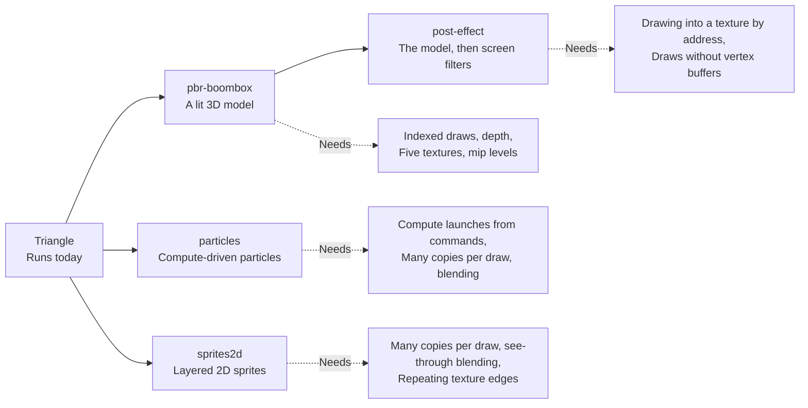
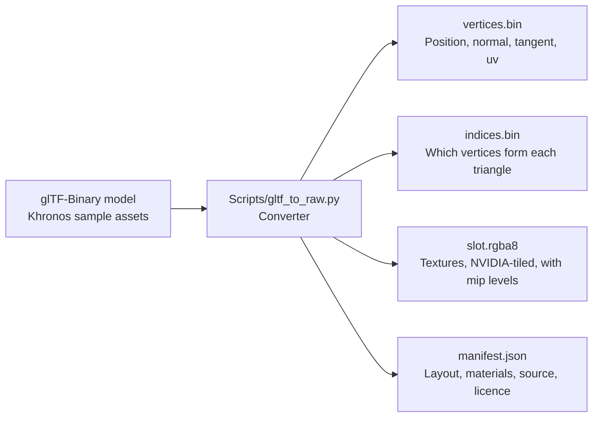

# Demos

The Qt window has buttons that draw through the GPU work today. Each planned scene needs one more missing feature, so the scenes double as a to-do list. For example, the Triangle button writes GPU commands into emulated memory every frame, and the full engine draws them.

## What runs today?

| Button | Code | What it proves |
|---|---|---|
| Render Test Frame | `frame::render_test_frame` | A translated SASS program (S2R, IMAD, STG) writes a 1080p gradient as a compute shader |
| Demo | `frame::render_demo_frame` | A hand-written SASS Julia set animates every frame; the time arrives through constant buffer 0 |
| Triangle | `frame::render_triangle_demo` | A command list in guest memory draws a turning triangle through the whole engine |

The Julia set program loops with a predicated branch, a jump taken only where a one-bit flag is set. It reuses one pipeline built once, so a frame costs a dispatch, a readback and a present.

| Julia set uses | Instructions |
|---|---|
| Float maths | FFMA, FMUL, FADD, FSETP |
| Special functions | MUFU.COS, SIN and LG2 |
| Conversions | I2F, F2I |
| Integer maths | IADD3, IMAD, LOP3 |
| Memory and flow | STG, predicated BRA |

Every frame ends in `display::present`, which the window shows.

Measured on an Intel Arc (MTL), p50 per frame:

| Demo | Time |
|---|---|
| Test frame, 1080p | 4.2 ms |
| Julia set | 4.7 ms |
| Pushbuffer triangle, 1080p | 6.6 ms |

## Which scenes come next?

*Each planned scene, and the engine features it needs first.*

| Scene | Content | Shaders |
|---|---|---|
| pbr-boombox | The BoomBox or Avocado model, lit with physically based materials and normal maps, one light | pbr.vert, pbr.frag |
| post-effect | The PBR scene drawn offscreen, then colour fringing, scanlines and a vignette | post.vert, post.frag |
| particles | Particles moved by a compute shader, drawn as glowing instanced squares | particles_update.comp, particles.vert, particles.frag |
| sprites2d | Scrolling layers and floating sprites, blended over a generated texture sheet | sprite2d.vert, sprite2d.frag |

Each scene document in `demos/scenes` lists its guest memory layout and the register writes it sends. Every convention not yet confirmed is tagged "(verify)". The shaders are GLSL that `glslangValidator -V` accepts. The plan is to compile them with NVIDIA's driver on a rented card, which yields the SM86 programs the scenes load.

Why compile GLSL on a desktop card: it yields real SM86 code for each stage. But it does not yield the Switch 2's shader header or attribute conventions, so those stay tagged until a real game shows them.

## Where do the assets come from?

*The converter turns a standard 3D model file into raw files the scenes copy into guest memory.*

BoomBox and Avocado are CC0 1.0 by Microsoft, from KhronosGroup's glTF-Sample-Assets. Base colour and emissive textures are sRGB, the others linear. DamagedHelmet is avoided because its source carries a non-commercial licence.

Verified by: an offscreen screenshot of each button's output, the engine acceptance test for the triangle, the Julia centre test, and the block-linear tiling matching the converter.

Sources: core/src/gpu/frame.rs, core/src/ffi.rs, gui-qt/src/MainWindow.cpp, demos/README, demos/scenes/*.md, demos/assets/README, scripts/gltf_to_raw.py, core/examples/perf.rs.
