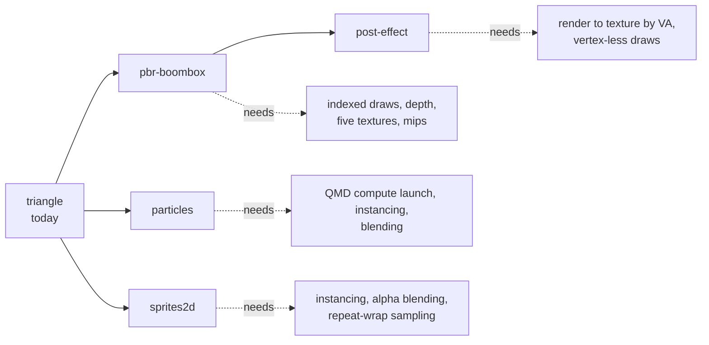
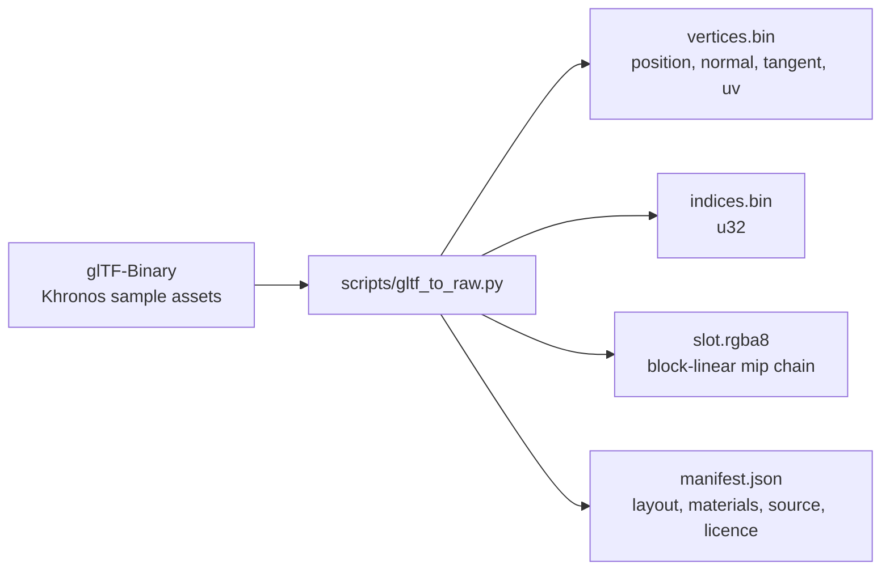

# Demos

The window has three buttons that draw through the GPU work today, and four scenes are planned that each pull in the next missing feature. Every frame ends in `display::present`, which the Qt display widget shows.

## What runs today

| button | code | what it proves |
|---|---|---|
| Render Test Frame | `frame::render_test_frame` | a translated SASS program (S2R, IMAD, STG) writes a 1080p gradient through compute |
| Demo | `frame::render_demo_frame` | a hand-assembled SASS Julia set animates every frame; time comes in through cbuf 0 |
| Triangle | `frame::render_triangle_demo` | a pushbuffer in guest memory draws a turning triangle through the whole engine |

The Julia set program uses FFMA, FMUL, FADD, FSETP, MUFU.COS, SIN and LG2, I2F, F2I, IADD3, IMAD, LOP3 and STG, with a predicated BRA loop. It re-dispatches one pipeline built once, so a frame costs a dispatch, a readback and a present.

measured on an Intel Arc (MTL), p50 per frame:

| demo | time |
|---|---|
| test frame, 1080p | 4.2 ms |
| Julia set | 4.7 ms |
| pushbuffer triangle, 1080p | 6.6 ms |

## The planned scenes

| scene | content | shaders |
|---|---|---|
| pbr-boombox | BoomBox or Avocado, metallic-roughness PBR with normal maps, one light | pbr.vert, pbr.frag |
| post-effect | the PBR scene offscreen, then chromatic aberration, scanlines and a vignette | post.vert, post.frag |
| particles | particles integrated by a compute dispatch, drawn as additive instanced quads | particles_update.comp, particles.vert, particles.frag |
| sprites2d | parallax layers and floating sprites, alpha-blended over a procedural atlas | sprite2d.vert, sprite2d.frag |

Each scene document in `demos/scenes` lists its guest memory map, the register program it writes, and tags every unconfirmed convention with "(verify)". The shaders are GLSL that `glslangValidator -V` accepts; the plan is to compile them with the NVIDIA driver on the silicon rig into the SM86 programs the scenes load.

Why GLSL compiled on a desktop card: it gives real SM86 code for the stages, but not the Switch 2's shader header or attribute conventions, so those stay tagged until a real title shows them.

## Assets

BoomBox and Avocado are CC0 1.0 by Microsoft, from KhronosGroup's glTF-Sample-Assets. Base colour and emissive are sRGB, the other slots linear. DamagedHelmet is avoided because its source carries a non-commercial licence.

Verified by: the GUI showing each button's output in an offscreen screenshot, the engine acceptance test for the triangle, the Julia centre test, and the block-linear swizzle matching the converter.

Sources: core/src/gpu/frame.rs, core/src/ffi.rs, gui-qt/src/MainWindow.cpp, demos/README, demos/scenes/*.md, demos/assets/README, scripts/gltf_to_raw.py, core/examples/perf.rs, design note "shader source research", project notes on the demo stream.
