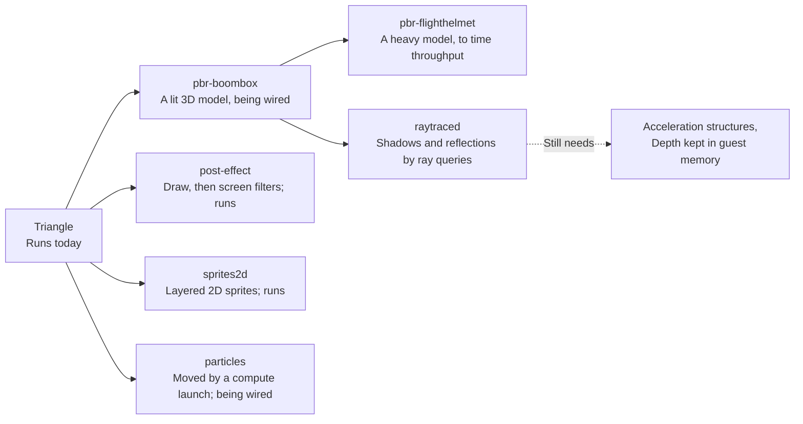
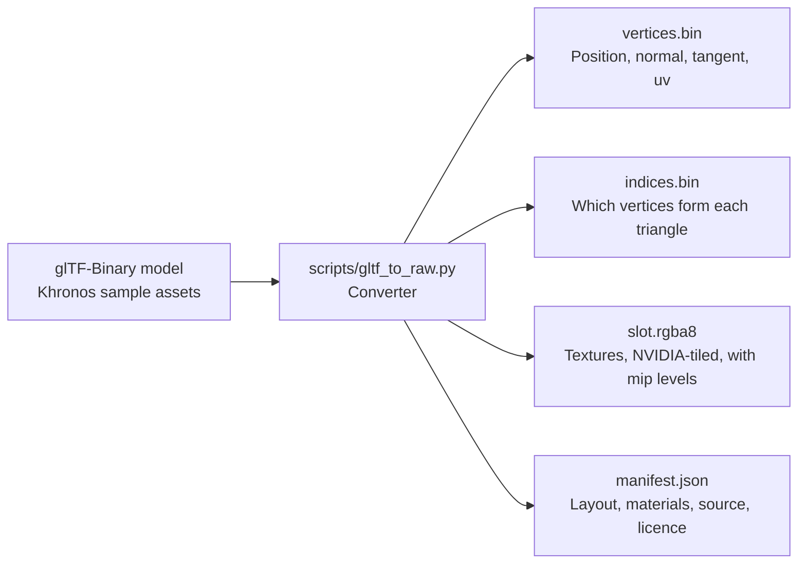

# Demos

The Qt window has buttons that draw through the GPU work today. Six bigger scenes are prepared: the post-effect and sprites scenes run, and the particles and BoomBox scenes are being wired. For example, the Triangle button writes GPU commands into emulated memory every frame, and the full engine draws them.

## What runs today?

| Button | Code | What it proves |
|---|---|---|
| Render Test Frame | `frame::render_test_frame` | A translated SASS program (S2R, IMAD, STG) writes a 1080p gradient as a compute shader |
| Demo | `frame::render_demo_frame` | A hand-written SASS Julia set animates every frame; the time arrives through constant buffer 0 |
| Triangle | `frame::render_triangle_demo` | A command list in guest memory draws a turning triangle through the whole engine |
| Post | `demo_post::render_post_frame` | NVIDIA-compiled shaders draw a pinwheel into one image, then sample it as a texture to add screen effects |
| Sprites | `demo_sprites::render_sprites_frame` | NVIDIA-compiled sprite shaders draw a scrolling parallax scene of blended sprites as one instanced draw |

The Julia set program loops with a predicated branch, a jump taken only where a one-bit flag is set. It reuses one pipeline built once, so a frame costs a dispatch, a readback and a present.

| Julia set uses | Instructions |
|---|---|
| Float maths | FFMA, FMUL, FADD, FSETP |
| Special functions | MUFU.COS, SIN and LG2 |
| Conversions | I2F, F2I |
| Integer maths | IADD3, IMAD, LOP3 |
| Memory and flow | STG, predicated BRA |

Every frame ends in `display::present`, which the window shows.

## What does it look like?

*Render Test Frame: a short SASS program (S2R, IMAD, STG) writes a gradient, translated to SPIR-V and run on an Intel laptop GPU.*

<video controls muted loop playsinline poster="https://raw.githubusercontent.com/jopdorp/oboromi/assets/julia-demo-poster.png" style="width:100%"><source src="https://raw.githubusercontent.com/jopdorp/oboromi/assets/julia-demo.mp4" type="video/mp4"></video>

*Demo: a hand-written SM86 program, translated to SPIR-V, redrawing a Julia set every frame on an Intel laptop GPU.*

<video controls muted loop playsinline poster="https://raw.githubusercontent.com/jopdorp/oboromi/assets/triangle-poster.png" style="width:100%"><source src="https://raw.githubusercontent.com/jopdorp/oboromi/assets/triangle.mp4" type="video/mp4"></video>

*Triangle: GPU commands written into emulated memory every frame, drawn through the whole engine on an Intel laptop GPU.*

*NVIDIA's cuda-samples Mandelbrot kernel, compiled by nvcc for SM86 and run unchanged through the translator on an Intel laptop GPU.*

<video controls muted loop playsinline poster="https://raw.githubusercontent.com/jopdorp/oboromi/assets/cuda-mandelbrot-zoom-poster.png" style="width:100%"><source src="https://raw.githubusercontent.com/jopdorp/oboromi/assets/cuda-mandelbrot-zoom.mp4" type="video/mp4"></video>

*The same CUDA kernel, launched once per frame with a smaller scale, zooming into the edge of the set.*

Measured on an Intel Arc (MTL), p50 per frame:

| Demo | Time |
|---|---|
| Test frame, 1080p | 4.2 ms |
| Julia set | 4.7 ms |
| Pushbuffer triangle, 1080p | 6.6 ms |

## Which scenes come next?

*The six prepared scenes and their state. The ray-traced one still needs two engine features.*

| Scene | Content | Shaders | State |
|---|---|---|
| pbr-boombox | The BoomBox or Avocado model, lit with physically based materials and normal maps, one light | pbr.vert, pbr.frag | In progress |
| post-effect | A scene drawn offscreen, then colour fringing, scanlines and a vignette; a pinwheel stands in for the PBR scene for now | post.vert, post.frag | Runs |
| particles | Particles moved by a compute shader, drawn as glowing instanced squares | particles_update.comp, particles.vert, particles.frag | Runs on its branch, being merged |
| sprites2d | Scrolling hill layers and floating sprites, blended over a sky | sprite2d.vert, sprite2d.frag | Runs |
| pbr-flighthelmet | The FlightHelmet model through the same PBR shaders, one draw per material, timed against pbr-boombox | pbr.vert, pbr.frag | In progress |
| raytraced | BoomBox on a ground plane with ray-query shadows and reflections, plus ray-traced ambient occlusion | rt.frag, rt_ao.comp | Prepared |

### What do the new scenes look like?

<video controls muted loop playsinline poster="https://raw.githubusercontent.com/jopdorp/oboromi/assets/demo-sprites-poster.png" style="width:100%"><source src="https://raw.githubusercontent.com/jopdorp/oboromi/assets/demo-sprites.mp4" type="video/mp4"></video>

*Sprites: NVIDIA-compiled sprite shaders draw scrolling hills and floating sprites, blended back to front, from a host-written command list.*

<video controls muted loop playsinline poster="https://raw.githubusercontent.com/jopdorp/oboromi/assets/demo-post-poster.png" style="width:100%"><source src="https://raw.githubusercontent.com/jopdorp/oboromi/assets/demo-post.mp4" type="video/mp4"></video>

*Post-effect: a pinwheel drawn into one image, then sampled as a texture by a second pass that adds the screen effects.*

<video controls muted loop playsinline poster="https://raw.githubusercontent.com/jopdorp/oboromi/assets/demo-particles-poster.png" style="width:100%"><source src="https://raw.githubusercontent.com/jopdorp/oboromi/assets/demo-particles.mp4" type="video/mp4"></video>

*Particles: a compute launch from the command list moves the particles, then one instanced draw shows them, still on its branch.*

*BoomBox: a still from the PBR scene while it is being wired.*

Each scene document in `demos/scenes` lists its guest memory layout and the register writes it sends. Every convention not yet confirmed is tagged "(verify)". The shaders are GLSL that `glslangValidator -V` accepts. The plan is to compile them with NVIDIA's driver on a rented card, which yields the SM86 programs the scenes load.

Why compile GLSL on a desktop card: it yields real SM86 code for each stage. But it does not yield the Switch 2's shader header or attribute conventions, so those stay tagged until a real game shows them.

## Where do the assets come from?

*The converter turns a standard 3D model file into raw files the scenes copy into guest memory.*

BoomBox, Avocado and FlightHelmet are CC0 1.0 by Microsoft, from KhronosGroup's glTF-Sample-Assets. FlightHelmet is too big for the code branches, so `demos/assets/fetch.sh` pulls it from the assets branch. Base colour and emissive textures are sRGB, the others linear. DamagedHelmet is avoided because its source carries a non-commercial licence.

Verified by: an offscreen screenshot of each button's output, the engine acceptance test for the triangle, the Julia centre test, and the block-linear tiling matching the converter.

Sources: core/src/gpu/frame.rs, core/src/ffi.rs, gui-qt/src/MainWindow.cpp, demos/README, demos/scenes/*.md, demos/assets/README, scripts/gltf_to_raw.py, core/examples/perf.rs.
