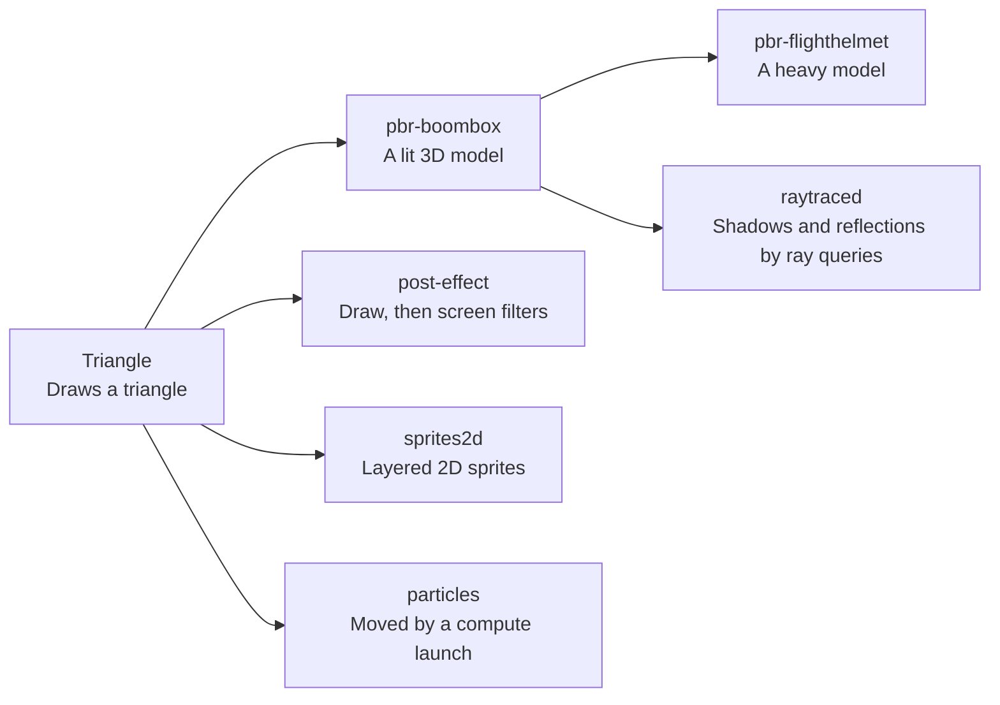
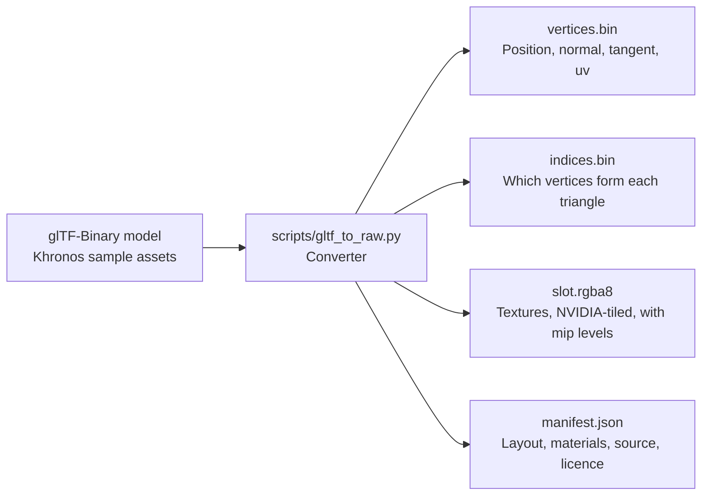

# Demos

The Qt window has buttons that draw through the GPU work today. Larger scenes show post effects, sprites, particles, BoomBox, FlightHelmet, ray tracing and a dungeon. For example, the Triangle button writes GPU commands into emulated memory every frame, and the full engine draws them.

## What runs today?

| Button | Code | What it proves |
|---|---|---|
| Render Test Frame | `frame::render_test_frame` | A translated SASS program (S2R, IMAD, STG) writes a 1080p gradient as a compute shader |
| Demo | `frame::render_demo_frame` | A hand-written SASS Julia set animates every frame; the time arrives through constant buffer 0 |
| Triangle | `frame::render_triangle_demo` | A command list in guest memory draws a turning triangle through the whole engine |
| Post | `demo_post::render_post_frame` | NVIDIA-compiled shaders draw a pinwheel into one image, then sample it as a texture to add screen effects |
| BoomBox | `demo::render_boombox_frame` | NVIDIA-compiled PBR shaders draw the BoomBox with five mipmapped textures and a depth buffer, turning once every eight seconds under a still light; run `demos/assets/fetch.sh` first |
| Helmet | `demo::render_helmet_frame` | The same path draws FlightHelmet's six materials, one draw each; run `demos/assets/fetch.sh` first |
| Sprites | `demo_sprites::render_sprites_frame` | NVIDIA-compiled sprite shaders draw a scrolling parallax scene of blended sprites as one instanced draw |
| Music | `demo_music::play_music` | A 16-bar loop plays through the audio renderer: synthesised samples on voices, a low-pass and an echo on the final mix |
| Bounce | `demo_bounce::render_bounce_frame` | Balls bounce in a box drawn with the particle shaders, and every hit plays a knock on a free voice |
| Dungeon | `demo_dungeon::render_dungeon_frame` | A torchlit tour with PBR materials, simulated water, particles, two quality presets and spatial audren sound |

The Julia set program loops with a predicated branch, a jump taken only where a one-bit flag is set. It reuses one pipeline built once, so a frame costs a dispatch, a readback and a present.

| Julia set uses | Instructions |
|---|---|
| Float maths | FFMA, FMUL, FADD, FSETP |
| Special functions | MUFU.COS, SIN and LG2 |
| Conversions | I2F, F2I |
| Integer maths | IADD3, IMAD, LOP3 |
| Memory and flow | STG, predicated BRA |

Every frame ends in `display::present`, which the window shows.

## What does it look like?

*Render Test Frame: a short SASS program (S2R, IMAD, STG) writes a gradient, translated to SPIR-V and run on an Intel laptop GPU.*

<video controls muted loop playsinline poster="https://raw.githubusercontent.com/jopdorp/oboromi/assets/julia-demo-poster.png" style="width:100%"><source src="https://raw.githubusercontent.com/jopdorp/oboromi/assets/julia-demo.mp4" type="video/mp4"></video>

*Demo: a hand-written SM86 program, translated to SPIR-V, redrawing a Julia set every frame on an Intel laptop GPU.*

<video controls muted loop playsinline poster="https://raw.githubusercontent.com/jopdorp/oboromi/assets/triangle-poster.png" style="width:100%"><source src="https://raw.githubusercontent.com/jopdorp/oboromi/assets/triangle.mp4" type="video/mp4"></video>

*Triangle: GPU commands written into emulated memory every frame, drawn through the whole engine on an Intel laptop GPU.*

*NVIDIA's cuda-samples Mandelbrot kernel, compiled by nvcc for SM86 and run unchanged through the translator on an Intel laptop GPU.*

<video controls muted loop playsinline poster="https://raw.githubusercontent.com/jopdorp/oboromi/assets/cuda-mandelbrot-zoom-poster.png" style="width:100%"><source src="https://raw.githubusercontent.com/jopdorp/oboromi/assets/cuda-mandelbrot-zoom.mp4" type="video/mp4"></video>

*The same CUDA kernel, launched once per frame with a smaller scale, zooming into the edge of the set.*

Measured on an Intel Arc (MTL), p50 per frame:

| Demo | Time |
|---|---|
| Test frame, 1080p | 4.2 ms |
| Julia set | 4.7 ms |
| Pushbuffer triangle, 1080p | 6.6 ms |

## Which scenes come next?

*The six scenes.*

| Scene | Content | Shaders |
|---|---|---|
| pbr-boombox | The BoomBox or Avocado model, lit with physically based materials and normal maps, one light | pbr.vert, pbr.frag |
| post-effect | A scene drawn offscreen, then colour fringing, scanlines and a vignette | post.vert, post.frag |
| particles | Particles moved by a compute shader, drawn as glowing instanced squares | particles_update.comp, particles.vert, particles.frag |
| sprites2d | Scrolling hill layers and floating sprites, blended over a sky | sprite2d.vert, sprite2d.frag |
| pbr-flighthelmet | The FlightHelmet model through the same PBR shaders, one draw per material | pbr.vert, pbr.frag |
| raytraced | BoomBox in a red and green room with two moving lights, soft ray-query shadows, mirror, glass and glossy floor reflections, ambient occlusion and one bounce of wall colour | pbr.vert, rt.frag |

The ray-traced scene runs through `demo::render_raytraced_frame` or the `capture` example with `raytraced`. It requires ray queries and fragment subgroup operations.

### What do the new scenes look like?

<video controls muted loop playsinline poster="https://raw.githubusercontent.com/jopdorp/oboromi/assets/demo-sprites-poster.png" style="width:100%"><source src="https://raw.githubusercontent.com/jopdorp/oboromi/assets/demo-sprites.mp4" type="video/mp4"></video>

*Sprites: NVIDIA-compiled sprite shaders draw scrolling hills and floating sprites, blended back to front, from a host-written command list.*

<video controls muted loop playsinline poster="https://raw.githubusercontent.com/jopdorp/oboromi/assets/demo-post-poster.png" style="width:100%"><source src="https://raw.githubusercontent.com/jopdorp/oboromi/assets/demo-post.mp4" type="video/mp4"></video>

*Post-effect: a pinwheel drawn into one image, then sampled as a texture by a second pass that adds the screen effects.*

<video controls muted loop playsinline poster="https://raw.githubusercontent.com/jopdorp/oboromi/assets/demo-particles-poster.png" style="width:100%"><source src="https://raw.githubusercontent.com/jopdorp/oboromi/assets/demo-particles.mp4" type="video/mp4"></video>

*Particles: a compute launch from the command list moves the particles, then one instanced draw shows them.*

<video controls muted loop playsinline poster="https://raw.githubusercontent.com/jopdorp/oboromi/assets/demo-boombox-poster.png" style="width:100%"><source src="https://raw.githubusercontent.com/jopdorp/oboromi/assets/demo-boombox.mp4" type="video/mp4"></video>

*BoomBox: the model turns on a turntable under a still light, so the shine and the glowing display move across it.*

<video controls muted loop playsinline poster="https://raw.githubusercontent.com/jopdorp/oboromi/assets/demo-raytraced-poster.png" style="width:100%"><source src="https://raw.githubusercontent.com/jopdorp/oboromi/assets/demo-raytraced.mp4" type="video/mp4"></video>

*Ray-traced BoomBox: The glossy floor mirrors the red and green walls, the chrome sphere reflects the room, the glass sphere bends it, and the moving lights sweep soft shadows.*

<video controls muted loop playsinline poster="https://raw.githubusercontent.com/jopdorp/oboromi/assets/demo-helmet-poster.png" style="width:100%"><source src="https://raw.githubusercontent.com/jopdorp/oboromi/assets/demo-helmet.mp4" type="video/mp4"></video>

*FlightHelmet: six materials and fifteen textures through the same shaders, one draw per material.*

<video controls loop playsinline poster="https://raw.githubusercontent.com/jopdorp/oboromi/assets/demo-music-poster.png" style="width:100%"><source src="https://raw.githubusercontent.com/jopdorp/oboromi/assets/demo-music.mp4" type="video/mp4"></video>

*Music: four instruments made at startup play a looping tune through the audio renderer, with a low-pass and an echo on the mix.*

<video controls loop playsinline poster="https://raw.githubusercontent.com/jopdorp/oboromi/assets/demo-bounce-poster.png" style="width:100%"><source src="https://raw.githubusercontent.com/jopdorp/oboromi/assets/demo-bounce.mp4" type="video/mp4"></video>

*Bounce: every hit plays a knock, higher for small balls and louder for hard hits, panned to where it happened.*

### Dungeon

<video controls loop playsinline poster="https://raw.githubusercontent.com/jopdorp/oboromi/assets/demo-dungeon-poster.png" style="width:100%"><source src="https://raw.githubusercontent.com/jopdorp/oboromi/assets/demo-dungeon.mp4" type="video/mp4"></video>

*Showcase: rendered offline at 1080p60 with ray-query shadows, reflections and ambient occlusion ON. Sized for the console; native Switch 2 performance remains unverified. Gentle river waves reveal the pebble bed, with filtered torch reflections, drifting volumetric mist, rounded wet formations and hanging stalactites with drips. Measured offline median frame time on Intel Arc MTL is 100.1 ms. The dungeon's shaders are compiled from GLSL for now.*

Console cost estimate: translated/twin efficiency cannot be measured while these shaders use native GLSL. Only raw Intel GPU measurements are available; a native console total below 16.7 ms has not been established.

| Pass | Realtime GPU ms | Showcase GPU ms | Translated/twin ratio | Native Switch 2 ms |
|---|---:|---:|---|---|
| Heightfield | 0.021 | 0.020 | N/A: native GLSL | unverified |
| Particle simulation | 0.043 | 0.036 | N/A: native GLSL | unverified |
| Planar reflection | 0.480 | 0.000 | N/A: native GLSL | unverified |
| Instanced cave formations | 0.148 | 0.141 | N/A: native GLSL | unverified |
| PBR, shadows and wet reflections | 4.803 | 88.338 | N/A: native GLSL | unverified |
| River surface | 0.015 | 0.056 | N/A: native GLSL | unverified |
| Flames, smoke and other sprites | 0.311 | 0.717 | N/A: native GLSL | unverified |
| Height fog, moon shaft and bloom prefilter | 0.298 | 0.472 | N/A: native GLSL | unverified |
| Bloom reconstruction, heat haze and tonemap | 1.875 | 1.308 | N/A: native GLSL | unverified |

<video controls loop playsinline poster="https://raw.githubusercontent.com/jopdorp/oboromi/assets/demo-dungeon-realtime-poster.png" style="width:100%"><source src="https://raw.githubusercontent.com/jopdorp/oboromi/assets/demo-dungeon-realtime.mp4" type="video/mp4"></video>

*Realtime preset: recorded offline at 1080p60, with baked shadows, filtered planar reflections and reduced particle, water, formation and fog budgets. Six selected lamps light each view. The standalone live-audio tour measures 9.67 ms median and 13.50 ms p95 on Intel Arc MTL. The dungeon's shaders are compiled from GLSL for now.*

Release measurements use 1200 frames per run, excluding the first three. GPU times
are Vulkan timestamp medians, summed within each frame across main and reflection
draws. Per-pass medians need not sum to the median total. Frame times include GPU
waits and audio but exclude PPM writes. Offline capture uses synchronous audio;
the live harness drains the audio ring on a separate clock without a window or audio
device. Both clips retain the approved round-three WAV and normalization.

| Run | Median frame ms | p95 frame ms | Median summed GPU ms |
|---|---:|---:|---:|
| Realtime live tour | 9.67 | 13.50 | 5.81 |
| Realtime cave entrance | 14.49 | 15.08 | 10.73 |
| Realtime cave downstream | 13.15 | 13.70 | 9.43 |
| Realtime offline capture | 18.38 | 34.90 | 8.04 |
| Showcase offline capture | 100.14 | 211.66 | 91.10 |

Cave GPU timings, realtime preset:

| Pass | Entrance ms | Downstream ms |
|---|---:|---:|
| Heightfield | 0.016 | 0.016 |
| Particle simulation | 0.035 | 0.035 |
| Planar reflection | 0.643 | 0.510 |
| Instanced cave formations | 0.836 | 1.042 |
| PBR, shadows and wet reflections | 6.450 | 5.000 |
| River surface | 0.248 | 0.455 |
| Flames, smoke and other sprites | 0.879 | 0.737 |
| Height fog, moon shaft and bloom prefilter | 0.279 | 0.280 |
| Bloom reconstruction, heat haze and tonemap | 1.326 | 1.341 |

Active graphics CPU in the live tour is 0.454 ms median. Recorded Vulkan commands are reused, heightfield vertices stay on the GPU, and the audio worker keeps mixing off the frame thread. No guest pushbuffer or FIFO decode is involved in this native GLSL path. These measurements do not establish stable 60 fps on other hardware.

The scene uses one opaque batch, instanced formations and sprites, and a water
draw; offscreen room batches and cave formations are culled. Realtime additionally
renders the reflected scene. Showcase uses 96 particles per light, a 256x64 water
grid, 24 quarter-resolution fog steps, four shadow rays per contributing flame,
one AO ray, one reflection ray on wet floors and three nearby rays on the river. Realtime uses 24 particles per
light, a 96x24 water grid, four fog steps and a 480x270 planar reflection. Ten
128px shadow cubemaps are baked, with at most two nearby lights
casting shadows; rock textures use the dominant face projection.
These are resource budgets, not measured console frame costs.

The Qt selector and `capture dungeon --quality realtime|showcase` select the presets;
`--raytracing on|off` overrides ray queries. `--water-debug normal|reflection|refraction`
isolates water inputs; `DUNGEON_WATER_DUMP=<directory>` writes the live heightfield
and raw reflection/refraction buffers for inspection. Intel Arc MTL supports the ray-query
showcase; devices without ray-query support use the raster fallback.
The [material manifest](https://github.com/jopdorp/oboromi/blob/audio-dungeon/demos/assets/dungeon-materials.md)
records the ambientCG assets and CC0 licence. Audio is drained directly to WAV
without opening a device, with the approved publication gain and limiter retained.

The other scene documents in `demos/scenes` list their guest memory layout and the register writes it sends. Every convention not yet confirmed is tagged "(verify)". The shaders are GLSL that `glslangValidator -V` accepts. NVIDIA's driver compiles them into the SM86 programs the scenes load.

Compiling GLSL on a desktop card gives real SM86 code for each stage. It does not give the Switch 2's shader header or attribute conventions, so those stay tagged until a real game shows them.

## Where do the assets come from?

*The converter turns a standard 3D model file into raw files the scenes copy into guest memory.*

BoomBox, Avocado and FlightHelmet are CC0 1.0 by Microsoft, from KhronosGroup's glTF-Sample-Assets. BoomBox and FlightHelmet are too big for the code branches, so `demos/assets/fetch.sh` pulls them from the assets branch. Base colour and emissive textures are sRGB, the others linear. DamagedHelmet is avoided because its source carries a non-commercial licence.

Verified by: an offscreen screenshot of each button's output, the engine acceptance test for the triangle, the Julia centre test, and the block-linear tiling matching the converter.

Sources: core/src/gpu/frame.rs, core/src/gpu/demo.rs, core/src/gpu/demo_bounce.rs, core/src/audio/demo_music.rs, core/src/ffi.rs, gui-qt/src/MainWindow.cpp, demos/README, demos/scenes/*.md, demos/assets/README, scripts/gltf_to_raw.py, core/examples/perf.rs.
