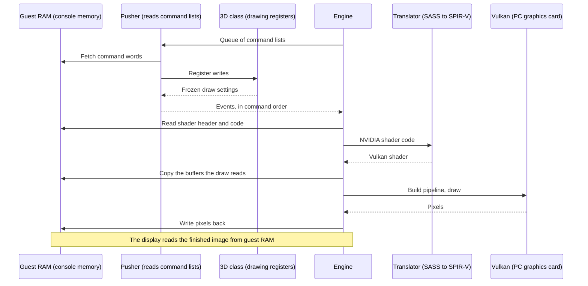
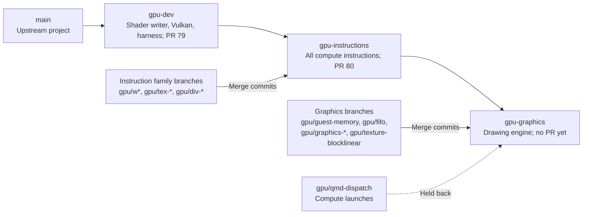

# GPU pipeline

A game draws by writing a list of commands into memory and telling the GPU where the list is. The emulator reads that list, collects the settings for each draw, rewrites the game's shaders for Vulkan, and draws on the PC's graphics card. For example, a triangle takes a handful of commands: where the shaders are, where the vertices are, the viewport, then "draw".

## How does a draw reach Vulkan?

*One draw, from the game's command list to pixels back in console memory.*

The words on this path:

- A **pushbuffer** is one command list in guest memory, and the **GPFIFO** is the queue of pointers to those lists.
- A **method** is one command: a write to a GPU engine's register.
- The **3D class** is the drawing engine's register set.
- **SASS** is NVIDIA's shader machine code, and **SPIR-V** is the shader format Vulkan accepts.
- A Vulkan **pipeline** bundles the shaders with the settings Vulkan must know before drawing.

## What happens at each step?

| Step | Code | Output |
|---|---|---|
| Read queue entries and command headers | fifo.rs `Pusher::submit` | Register writes, each aimed at one engine |
| Bind engines to slots, run channel commands | fifo.rs `channel` | Semaphore events, the GPU's "I got this far" signals |
| Keep the drawing registers, freeze them at each draw | threed.rs `ThreeD::write` | `Event::Draw(DrawSnapshot)` |
| Read the shader header (SPH) and code, translate | engine.rs `module`, sm86 `translate_program` | SPIR-V, cached by a hash of header and code |
| Copy the buffers the draw reads | engine.rs `mirror` | Host buffers, keyed by where they sit in guest RAM |
| Draw and read back | graphics.rs `VkState::draw` | RGBA8 pixels |
| Write back and show | engine.rs `draw`, `present` | Guest memory, then `display::present` |

## Why does submit wait for every draw?

`Gpu::submit` returns only after every draw has landed in guest memory. So any later CPU read sees the result, with no extra waiting. See [ADR-0006](../adr/0006-synchronous-pusher-with-draw-snapshots.md).

## Why freeze the settings at each draw?

A draw must see the registers as they were when it was issued. The frozen copy, the snapshot, keeps later commands from changing a draw that is still running.

## Does compute work take the same road?

Yes, through the compute class 0xC7C0. A QMD, the block in guest memory that describes one compute launch, becomes a dispatch snapshot (see [command processor](command-processor-and-memory.md)). The engine does not run it yet.

## Which branch holds what?

*Each branch stacks on the one to its left; side branches merge in with merge commits.*

| Branch | Holds | Upstream |
|---|---|---|
| gpu-dev | The SPIR-V writer, the Vulkan device and compute dispatch, the display widget, the test harness, the perf example and profile script, CI tools | PR #79, which contains #69 to #78 |
| gpu-instructions | Every compute instruction family, divergence, textures, tensor cores, silicon fixtures (recordings from a real card), the Julia demo, the CUDA runners | PR #80, stacked on #79 |
| gpu-graphics | Guest memory, the command reader and 3D class, the graphics backend and shader stages, the engine, tiled textures, demo assets and scenes | Not opened |
| gpu/qmd-dispatch | The compute class and QMD reading | Pushed, waiting on the engine hooks |

Each level merges the one below whenever it moves, with merge commits and never a rebase. The gpu-graphics branch last merged gpu-instructions before the CUDA commits. So `cubin.rs` and `cuda.rs` are only on gpu-instructions for now.

Verified by: the engine acceptance test `pushbuffer_triangle_lands_in_guest_memory_and_follows_vertex_remaps` on Intel and lavapipe (Mesa's CPU-based Vulkan driver), with the Vulkan validation layer reporting no errors.

Sources: core/src/gpu/{fifo,threed,engine,graphics}.rs, core/src/tests/gpu/engine.rs, PR #79 and #80 bodies, git history of the fork.
