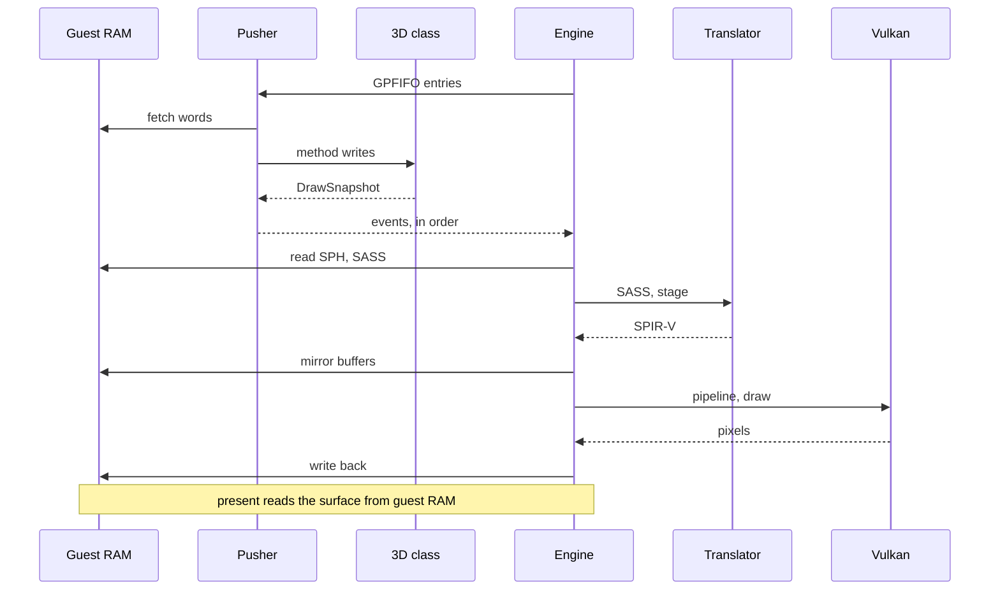
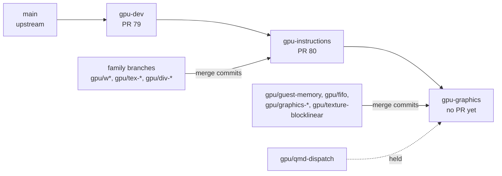

# GPU pipeline

A guest asks the GPU for work by writing a pushbuffer into its own memory and pointing a GPFIFO entry at it. oboromi follows that path end to end: decode the methods, collect the 3D state into a snapshot at each draw, translate the guest's shader machine code, draw with Vulkan, and write the result back to guest memory, where the display reads it.

## The steps

| step | code | output |
|---|---|---|
| decode GPFIFO entry and method headers | fifo.rs `Pusher::submit` | method writes per subchannel |
| bind classes with SET_OBJECT, run channel methods | fifo.rs `channel` | semaphore events |
| keep the 3D register file, snapshot at draw triggers | threed.rs `ThreeD::write` | `Event::Draw(DrawSnapshot)` |
| read shader headers and code, translate | engine.rs `module`, sm86 `translate_program` | SPIR-V, cached by SPH and code hash |
| mirror buffers the draw reads | engine.rs `mirror` | host buffers keyed by guest-physical ranges |
| draw and read back | graphics.rs `VkState::draw` | RGBA8 pixels |
| write back and present | engine.rs `draw`, `present` | guest memory, then `display::present` |

Why synchronous: `Gpu::submit` returns only after every draw has landed in guest memory, so any later CPU read sees it. See [ADR-0006](../adr/0006-synchronous-pusher-with-draw-snapshots.md).

Why a snapshot: the draw sees the registers as they were at the trigger, and later method writes cannot change a draw in flight.

Compute work takes the same road through class 0xC7C0: a QMD in guest memory becomes a dispatch snapshot (see [command processor](command-processor-and-memory.md)). Its execution in the engine is not wired yet.

## Branch map

| branch | holds | upstream |
|---|---|---|
| gpu-dev | SPIR-V emitter sections, lazy types, owned Vulkan device, compute dispatch, display widget, register-io harness, perf example, profile script, CI tools | PR #79, which contains #69 to #78 |
| gpu-instructions | every compute instruction family, divergence, textures, tensors, silicon fixtures, Julia demo, cubin runner, native CUDA | PR #80, stacked on #79 |
| gpu-graphics | guest memory, GPFIFO and 3D class, graphics backend and stages, engine, block-linear textures, demo assets and scenes | not opened |
| gpu/qmd-dispatch | 0xC7C0 class and QMD decode | pushed, waiting on the engine hooks |

Each level merges the one below whenever it moves, with merge commits, never a rebase. gpu-graphics last merged gpu-instructions before the CUDA commits, so `cubin.rs` and `cuda.rs` are on gpu-instructions only for now.

Verified by: the engine acceptance test `pushbuffer_triangle_lands_in_guest_memory_and_follows_vertex_remaps` on Intel and lavapipe, with the Vulkan validation layer clean.

Sources: core/src/gpu/{fifo,threed,engine,graphics}.rs, core/src/tests/gpu/engine.rs, PR #79 and #80 bodies, git history of the fork.
