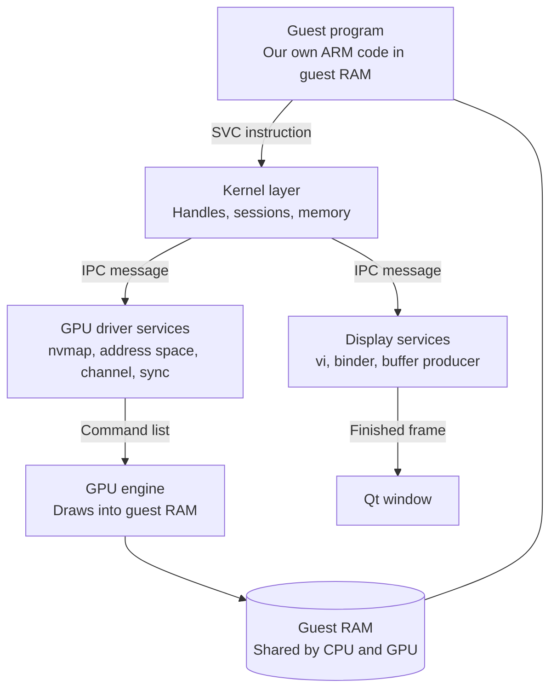

# Guest path

Today the GPU tests write command lists into guest memory themselves. The guest path replaces them with a small program of our own. It runs on the emulated CPU and goes through the same steps a game does. For example, it asks the GPU driver service for memory, submits a triangle, waits for it, and hands the frame to the display service.

*The path a self-written guest program takes from its own code to the window.*

## Why write our own guest program first?

A real game needs a loader for its file formats, threads, a scheduler and many more services. Our own program needs only the parts on the path to the screen, and we know exactly what it should do. Each step of the path is then tested with real guest calls, and the deferred parts can come later.

## What does the guest program look like?

It is Rust without the standard library, built for bare-metal AArch64. It has its own start code, and it makes system calls with inline assembly.

| Guest fact | Value |
|---|---|
| Target | `aarch64-unknown-none`, `no_std` |
| Image | A flat binary, loaded unchanged and started at its first byte |
| Load address | 0x0800_0000 |
| Stack | Grows down from the load address |
| Built by | `scripts/build-guest.sh`, committed as a test fixture |

It has three parts on the `guest/scene-crate` branch:

- `svc.rs`: the system calls, with arguments in registers x0 to x7 and the result code back in w0.
- `cmif.rs`: an encoder for service requests and replies, laid out as the libnx homebrew library does.
- `nvdrv.rs`: the GPU driver's ioctl numbers and argument layouts.

The scene encoders, which build command lists, shader headers and texture headers, moved into a shared `no_std` crate called `scene`. The host tests and the guest program use the same encoders, so a scene is defined once.

## Which calls does it make, in order?

| Step | Calls | Purpose |
|---|---|---|
| 1 | Connect to `nvdrv`, `Initialize`, open the device files | Reach the GPU driver |
| 2 | Read the GPU characteristics | Learn the chip, as a game does |
| 3 | `nvmap` create and alloc | Describe memory for the command list and the frame |
| 4 | Address space init, alloc space, map buffer | Give that memory GPU addresses |
| 5 | Channel setup and `AllocGpfifoEx2` | Open a GPU channel with a command queue |
| 6 | `SubmitGpfifo` | Submit the triangle's command list, get a fence |
| 7 | Sync-point wait | Check the fence was reached |
| 8 | Open the display and a layer, then connect a buffer producer | Get somewhere to show the frame |
| 9 | `SetPreallocatedBuffer`, `DequeueBuffer`, `QueueBuffer` | Hand the frame to the display |

## What is the acceptance test?

The guest maps memory through the nvmap and address-space ioctls, submits the triangle command list with `SubmitGpfifo`, and polls the fence. It then queues the buffer through the binder, and the window shows the triangle. A second frame with changed vertices must show the change, which proves no stale copy of the old vertices was used.

## How far along is it?

| Step | State |
|---|---|
| One RAM block shared by CPU and GPU, with write tracking | Done on the `guest-path` branch |
| Guest image, loader and shared scene crate | Done on the `guest/scene-crate` branch; the guest reaches its first system call |
| Kernel layer: system calls, handles, memory regions | In progress |
| IPC sessions and service dispatch | Planned |
| GPU driver services and submission | Planned; the guest side of the calls is written |
| Display services and the binder | Planned |
| Guest demo button and the acceptance test | Planned |

Left for later on purpose: threads and a scheduler, asynchronous events, and domains, which are several service objects on one session. The game file loaders, the full service manager, and thread-local storage beyond the IPC buffer also come later.

Verified by: `the_guest_image_reaches_its_debug_string_svc` on the `guest/scene-crate` branch, and the shared-memory tests listed on the [CPU](cpu.md) page.

Sources: core/src/guest.rs, guest/ and scene/ on guest/scene-crate, core/src/cpu/guest_ram.rs on guest-path, switchbrew's NV services and HIPC pages, libnx's nvidia ioctl sources.
