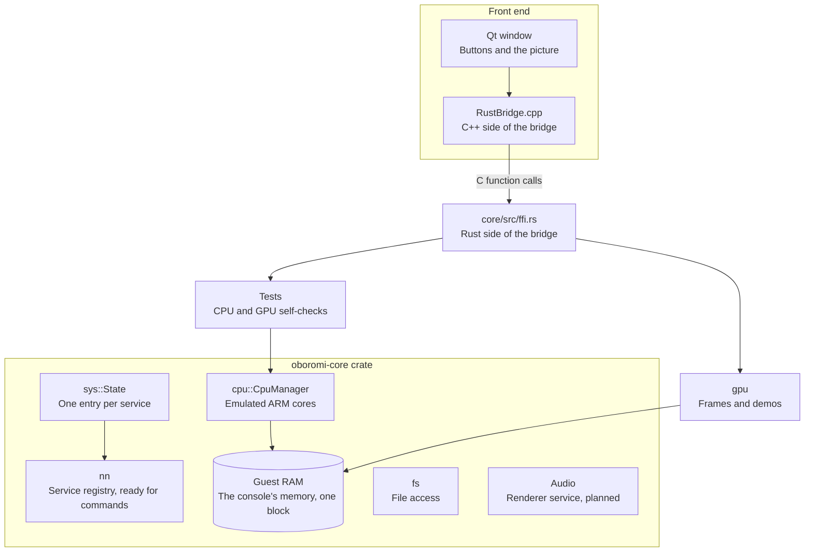

# Emulator overview

oboromi already had the foundations every other part builds on. Those include the project layout, a multicore ARM CPU on one shared memory block, and a registry of the console's services. They also include the GPU instruction table with its decoder generator. For example, the GPU translator decodes every instruction with that generator, and the GPU reads the same memory block the CPU cores share.

*The parts around the GPU, and how the window reaches them.*

## What was already there?

| Foundation | Where | What it gives the rest of the project |
|---|---|---|
| Project structure | Cargo workspace, `core`, `gui-qt` | One Rust core with a C interface, used by a separate Qt front end |
| Multicore CPU | core/src/cpu | Eight ARM cores on Unicorn, all mapping one shared RAM block at guest address 0 |
| Service registry | core/src/nn, core/src/sys | 160 named services, each with a slot in the system state, ready for its commands |
| IPC header types | core/src/nn/hipc.rs | The data types of the Switch's service message header |
| SM86 instruction table and decoder generator | scripts/ | The decoder for every GPU instruction is generated from NVIDIA's own table |
| SPIR-V emitter | core/src/gpu/spirv.rs | The writer every translated shader goes through |
| Qt front end | gui-qt | The window, its buttons and the bridge into the Rust core |
| CI | .github/workflows | Builds and tests on Linux, Windows and macOS |

## What does each part do today, and what is next?

| Part | Where | Today | Next | Page |
|---|---|---|---|---|
| CPU cores and RAM | core/src/cpu | Run, step, read and write registers and memory on every core | Share the RAM with the GPU, in progress on the `guest-path` branch | [CPU](cpu.md) |
| Kernel layer | core/src/kernel, planned | Not started in the core; the test guest already issues system calls | System-call dispatch, handles, memory regions, IPC | [CPU](cpu.md) |
| Services | core/src/nn | The registry and the message header types | Sessions, then the GPU driver and display services | [Services](services.md) |
| Audio | core/src/audio | Module in place | The audio renderer service and output through Qt, designed | [Audio](audio.md) |
| Loader | planned | Tests place guest code in memory | A flat image loader for our own guest first, game formats later | [Guest path](guest-path.md) |
| Filesystem | core/src/fs | Maps a file into memory | Game file formats, planned | |
| Display | core/src/display.rs | Holds the last frame and tells the window | The display services feed it, planned | [Guest path](guest-path.md) |
| GPU | core/src/gpu | Translates and runs shaders, draws from command lists | See the GPU pages | [GPU pipeline](gpu-pipeline.md) |

## How does a frame reach the window?

The core never calls the window directly. A renderer calls `display::present`, which copies the pixels, bumps a frame counter and fires a callback the window registered. The window then reads the frame through the C interface and scales it to fit.

Why: the window redraws only when a frame arrives, and the core stays testable without a window.

## Why does the GPU work start at the hardware?

A game reaches the GPU through the kernel and the GPU driver services, and both are still being built. So the GPU work started where the hardware starts, and tests write command lists into guest memory the way the driver would. The [guest path](guest-path.md) replaces those tests with a real program that goes through the system calls and services.

Verified by: the CPU self-tests (`core/src/tests/run.rs`, `multicore_test.rs`) and an offscreen screenshot of the window after Render Test Frame.

Sources: core/src/cpu/cpu_manager.rs, core/src/cpu/unicorn_interface.rs, core/src/nn/mod.rs, core/src/nn/hipc.rs, core/src/sys/mod.rs, core/src/display.rs, core/src/ffi.rs, gui-qt/src/MainWindow.cpp, .github/workflows/ci.yml, README.md.
