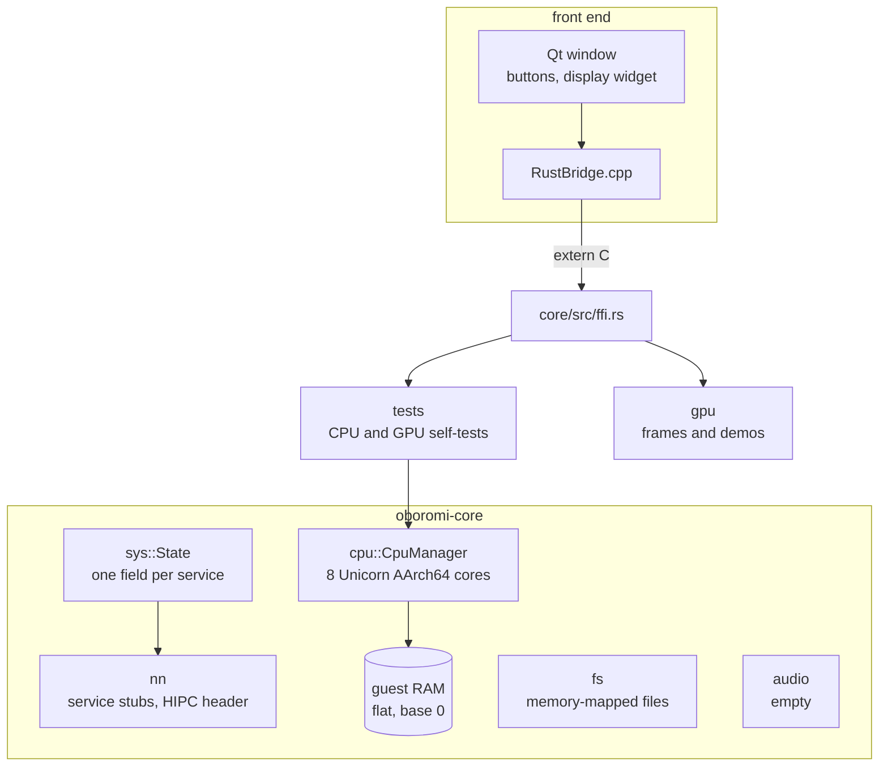

# oboromi overview

oboromi is a Rust emulator for the Nintendo Switch 2, with a Qt front end over a C FFI. It is early: it cannot boot firmware or a game. This page maps the parts outside the GPU in rough strokes, so the GPU pages have context.

## The parts

| part | where | what it does today | state |
|---|---|---|---|
| CPU cores | core/src/cpu | eight Unicorn AArch64 cores share one pinned RAM block; run, step, registers, reads and writes | real |
| guest RAM | cpu_manager.rs | one flat 12 GiB block at address 0, lazily backed by the host OS | real |
| loader | none | no NSO, NRO or ELF loader, so guest code is placed by tests | missing |
| SVCs and hooks | none | no supervisor calls, no memory hooks | missing |
| services | core/src/nn | a `State {}` per service name, registered by `start_host_services`; HIPC decodes a header and ignores it | stub |
| GPU services | nn: nvdrv, nvmap names, vi, host1x | names only, no ioctls; the GPU work drives the GPU directly | stub |
| filesystem | core/src/fs | a memory-mapped file wrapper | stub |
| audio | core/src/audio | empty module | stub |
| display | core/src/display.rs | holds the last presented RGBA8 frame and calls the GUI back | real |
| FFI | core/src/ffi.rs | test runners, frame render calls, frame read and callback | real |
| GUI | gui-qt | CPU and GPU test buttons, Render Test Frame, Demo and Triangle toggles, the display widget | real |

## How a frame reaches the window

The core never touches the GUI. A renderer calls `display::present`, which bumps a generation counter, copies the pixels and fires the registered C callback. The Qt display widget then reads the frame through FFI and letterboxes it.

Why: event driven, no polling, and the core stays testable without a window.

## What this means for the GPU work

Nothing upstream of the GPU exists yet: no game issues ioctls, and no channel or address space is set up by the OS layer. So the GPU work starts at the hardware interface and is driven by host-written pushbuffers in guest memory. When a loader and `nvdrv` exist, they plug in where those tests write today.

Verified by: the CPU self-tests (`core/src/tests/run.rs`, `multicore_test.rs`) and an offscreen screenshot of the window after Render Test Frame.

Sources: core/src/cpu/cpu_manager.rs, core/src/cpu/unicorn_interface.rs, core/src/nn/mod.rs, core/src/nn/hipc.rs, core/src/sys/mod.rs, core/src/display.rs, core/src/ffi.rs, gui-qt/src/MainWindow.cpp, README.md, design note "graphics codebase".
