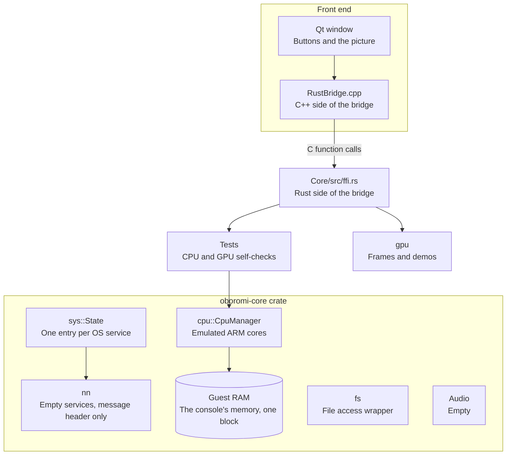

# Emulator overview

Outside the GPU, oboromi is a skeleton: the emulated CPU runs, but nothing loads a game and the operating system services are names only. So no game ever sends the GPU work. Tests write GPU commands into emulated memory by hand instead, the way a game's graphics driver would.

*The parts outside the GPU, and how the window reaches them.*

## Which parts exist?

| Part | Where | What it does today | State |
|---|---|---|---|
| CPU cores | Core/src/cpu | Eight emulated ARM cores on Unicorn, a CPU emulator library; they share one memory block and can run, step, and read or write registers and memory | Real |
| Guest RAM | cpu_manager.rs | One flat 12 GiB block at address 0; the host OS only backs the parts that are touched | Real |
| Loader | None | Nothing reads a game's executable (NSO, NRO or ELF), so tests place guest code by hand | Missing |
| System calls | None | No SVCs, the calls a game makes into the Switch kernel, and no memory hooks | Missing |
| Services | Core/src/nn | An empty `State {}` per OS service name; HIPC, the Switch's service message format, has its header decoded and ignored | Stub |
| GPU services | nn: nvdrv, nvmap, vi, host1x | The GPU driver, GPU memory, display and sync services exist as names only, with no ioctls (driver control calls) | Stub |
| Filesystem | Core/src/fs | A wrapper that maps a file into memory | Stub |
| Audio | Core/src/audio | An empty module | Stub |
| Display | Core/src/display.rs | Holds the last finished frame and tells the window | Real |
| FFI | Core/src/ffi.rs | The Rust functions the C++ window calls: run tests, render frames, read the frame | Real |
| GUI | Gui-qt | Buttons for CPU and GPU tests, Render Test Frame, Demo and Triangle, and the picture | Real |

## How does a frame reach the window?

The core never calls the window directly. A renderer calls `display::present`, which copies the pixels, bumps a frame counter and fires a callback the window registered. The window then reads the frame through FFI and scales it to fit.

Why: the window redraws only when a frame arrives, and the core stays testable without a window.

## Why does the GPU work start at the hardware?

Nothing above the GPU exists yet. No game makes GPU driver calls, and the OS layer sets up no command stream or GPU address space. So the GPU work starts where the hardware starts, and tests write its command lists into guest memory. When a loader and the `nvdrv` GPU driver service exist, they will write those lists instead.

Verified by: the CPU self-tests (`core/src/tests/run.rs`, `multicore_test.rs`) and an offscreen screenshot of the window after Render Test Frame.

Sources: core/src/cpu/cpu_manager.rs, core/src/cpu/unicorn_interface.rs, core/src/nn/mod.rs, core/src/nn/hipc.rs, core/src/sys/mod.rs, core/src/display.rs, core/src/ffi.rs, gui-qt/src/MainWindow.cpp, README.md.
