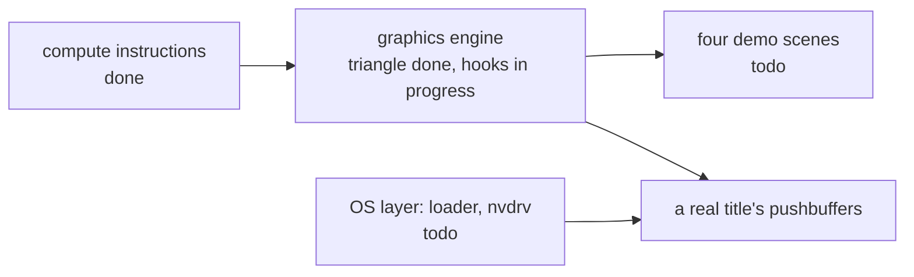

# Roadmap

Where the GPU work stands, by area. "By design" means left out on purpose, with a named panic, until something needs it.

## Open items

| area | item | status |
|---|---|---|
| translator | every compute instruction family, incl. textures, tensors and divergence | done |
| translator | vertex and fragment stages: ALD, AST, IPA, fragment outputs and depth | done |
| translator | geometry and tessellation transport: ISBERD, ISBEWR, LDTRAM, OUT, PIXLD | by design |
| translator | ray tracing TTU ops, sparse tensor ops, FOOTPRINT, SUQUERY, UCLEA | by design |
| translator | float atomics (need VK_EXT_shader_atomic_float), implicit-LOD TEX in compute | todo |
| command processor | GPFIFO, SET_OBJECT, channel semaphores, 3D class and draw snapshots | done |
| command processor | 0xC7C0 QMD decode | in progress, own branch |
| command processor | MME64 macros, 2D, DMA and inline-to-memory classes, semaphore acquire | todo |
| engine | pushbuffer triangle with cbufs, clear, report and VA remap | done |
| engine | QMD dispatch execution, indexed draws, depth, blending, textures in draws, render to texture | in progress |
| textures | pitch and block-linear, mip chains, sRGB, R8, RG8, RGBA16F, R32UI, BC1, BC3, BC7 | done |
| textures | other formats, swizzles, 3D, cube and array textures, dynamic descriptor arrays | todo |
| tensors | HMMA, IMMA, DMMA, BMMA, LDSM, MOVM with the silicon accumulation model | done |
| verification | session 6 captures (TF32, IMMA saturation per k16 half, conversions, indexed MOV) | todo: not replayed yet |
| CUDA | cubin runner, native path on libcuda, the three division fixes | done |
| CUDA | more cuda-samples kernels | todo |
| demos | pbr-boombox, post-effect, particles, sprites2d | todo |
| OS layer | loader, SVCs, nvdrv, nvmap and address-space ioctls, syncpoints, vi | todo |
| upstream | PR #79 and PR #80 | open |
| upstream | a PR for gpu-graphics | not opened |

## Honest limits

- No game boots. There is no loader, and the GPU is driven by host-written pushbuffers.
- Nothing has run on a Switch 2. Instruction semantics are verified on GA102 (RTX 3090, A6000), which is the same Ampere SM; the T239's encoding table is identical, its runtime behaviour is assumed equal by design.
- Shader program header size: the engine reads code after a 0x50-byte header and finds its end at the branch-to-self; NAK says the version 4 header is 32 words, which puts code at 0x80. Unresolved until a real title's shader is read.
- The GPU page size is Ryujinx's big page size; the T239 value is unverified.
- The base-vertex behaviour of VertexIndex and the front-facing value are unverified.
- Graphics-stage code has only been written by hand and by desktop compilers, never taken from a Switch 2 title.

Verified by: each "done" row links to its tests on the subsystem page; "in progress" rows are unmerged branches.

Sources: core/src/gpu/sm86/*.rs (named todos), core/src/gpu/engine.rs (errors by name), core/src/gpu/memory.rs, demos/README, PR #79 and #80, project notes on the graphics plan, open questions and silicon session 6.
