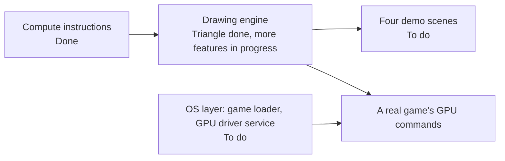

# Roadmap

The compute side of the translator is done, and the graphics engine draws its first triangle. No real game runs yet, because the OS layer that would load one is missing. For example, no game can ask the GPU driver service for memory, so tests set the GPU up by hand.

"By design" below means left out on purpose, with a named panic, until something needs it.

*What has to land before a real game's commands can reach the GPU work.*

## What is done and what is open?

| Area | Item | Status |
|---|---|---|
| Translator | Every compute instruction family, including textures, tensors and divergence | Done |
| Translator | Vertex and pixel shaders: ALD, AST, IPA, pixel outputs and depth | Done |
| Translator | Geometry and tessellation data transport: ISBERD, ISBEWR, LDTRAM, OUT, PIXLD | By design |
| Translator | Ray tracing TTU ops, sparse tensor ops, FOOTPRINT, SUQUERY, UCLEA | By design |
| Translator | Float atomics (need VK_EXT_shader_atomic_float), texture reads with implicit detail level in compute | To do |
| Command processor | GPFIFO, SET_OBJECT, channel semaphores, 3D class and draw snapshots | Done |
| Command processor | Reading compute launch blocks (QMD) for class 0xC7C0 | In progress, own branch |
| Command processor | MME64 macros, 2D, DMA and inline-to-memory classes, semaphore acquire | To do |
| Engine | Command-list triangle with constant buffers, clear, report and address remap | Done |
| Engine | Running compute launches, indexed draws, depth, blending, textures in draws, drawing into textures | In progress |
| Textures | Plain and tiled layouts, mip chains, sRGB, R8, RG8, RGBA16F, R32UI, BC1, BC3, BC7 | Done |
| Textures | Other formats and channel orders, 3D, cube and array textures, texture arrays picked at run time | To do |
| Tensors | HMMA, IMMA, DMMA, BMMA, LDSM, MOVM with the chip's exact sums | Done |
| Verification | Session 6 recordings (TF32, IMMA saturation per k16 half, conversions, indexed MOV) | To do: not replayed yet |
| CUDA | cubin runner, native path on libcuda, the three division fixes | Done |
| CUDA | More cuda-samples kernels | To do |
| Demos | pbr-boombox, post-effect, particles, sprites2d | To do |
| OS layer | Loader, system calls, nvdrv, nvmap and address-space calls, syncpoints, vi | To do |
| Upstream | PR #79 and PR #80 | Open |
| Upstream | A PR for gpu-graphics | Not opened |

## What are the honest limits?

- No game boots. There is no loader, and tests write the GPU's command lists by hand.
- Nothing has run on a Switch 2. Instructions are checked on desktop GA102 cards, the same Ampere core. The Switch 2's instruction table is identical, and its behaviour is assumed equal.
- The shader header size is unresolved, see the table below, until a real game's shader is read.
- The GPU page size is Ryujinx's big page size; the Switch 2's value is unverified.
- How the vertex id treats a base vertex, and the front-facing value, are unverified.
- Graphics shaders so far were written by hand or by desktop compilers, never taken from a Switch 2 game.

| Shader header question | Value |
|---|---|
| Where the engine reads code today | After a 0x50-byte header, ending at the branch-to-self |
| What NAK, Mesa's NVIDIA compiler, says | The version 4 header is 32 words, so code starts at 0x80 |

Verified by: each "done" row links to its tests on the subsystem page; "in progress" rows are unmerged branches.

Sources: core/src/gpu/sm86/*.rs (named todos), core/src/gpu/engine.rs (errors by name), core/src/gpu/memory.rs, demos/README, PR #79 and #80.
