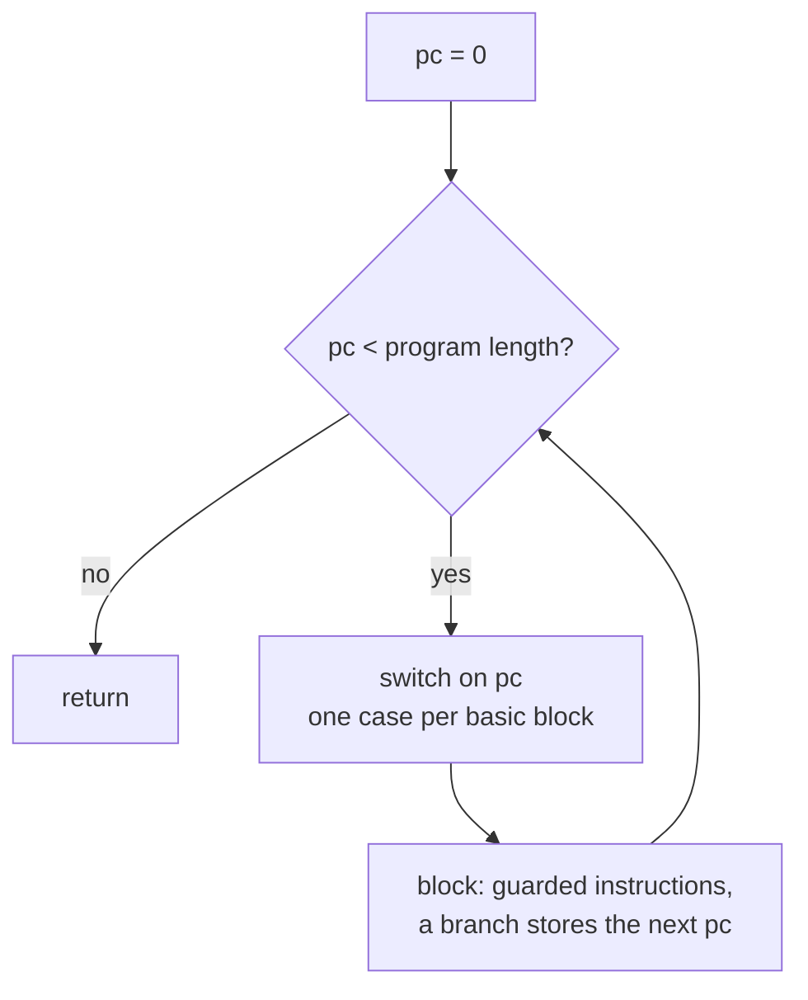

# SASS translator

The translator turns SM86 machine code into one SPIR-V module per program. It decodes each 128-bit instruction with a table generated from NVIDIA's own instruction description, keeps the guest register file in shader memory, and runs the program as a loop over a program counter.

## Decoder

`scripts/decoder_generator.rs` reads `scripts/sm_86_instructions.txt`, the instruction table nvdisasm carries (extracted the DocumentSASS way), and writes `sm86_decoder_generated.rs`: one branch per encoding class, keyed on bit 91 and bits 11:0, calling a handler per opcode family. Alternate-syntax classes are skipped so a pseudo-op never shadows the real instruction. An unknown word panics.

Why the SM86 table for the Switch 2's T239: CUDA 13.1's nvdisasm ships byte-identical tables for SM86, SM87 and SM88, and SM88 is the T239's GA10F. No class, field or key differs. See [ADR-0007](../adr/0007-t239-decodes-with-the-sm86-table.md).

## State model

| guest state | SPIR-V home | note |
|---|---|---|
| R0 to R253, RZ | Private u32 array per invocation | RZ reads zero |
| P0 to P6, PT | one Private word of bits | PT is constant true |
| UR0 to UR62, UP | same array, after the predicates | uniform datapath |
| live | last word of the array | dead lanes start past the end |
| pc, return pcs, BSSY tokens B0 to B15 | Private variables | |
| local memory | Private array | 4 KiB per lane |
| shared memory | Workgroup array | 1 KiB per workgroup |
| warp exchange, schedule slots | Workgroup arrays | collectives and divergence |

## Control flow

Vulkan only takes structured control flow, so guest branches store a pc and one loop around a switch dispatches on it. Basic blocks start at 0, at branch targets, after branches and EXIT, at BSYNC and after BAR. A program with BRX, JMX or CALL through a register makes every pc a leader. EXIT stores a pc past the end. A predicated instruction `@Pg` is wrapped in a selection on its predicate; uniform ops guard on UP.

## Divergence

A warp is 32 consecutive invocations. Programs without collectives keep a free per-lane loop. Programs with VOTE, SHFL, MATCH, REDUX, BAR, tensor ops, LDSM, MOVM or R2UR.OR run workgroup-uniform: each step every invocation votes, the lowest runnable pc runs, lanes at other pcs sit the step out with their effects masked. Collectives trade values through a Workgroup array between two barriers. BSSY stores a token per lane; BSYNC blocks while a warp peer holds the same token elsewhere. BAR arrivals are counted per barrier id and released when complete. A stuck program reports live = 2 and the harness panics.

Why: workgroup barriers must be reached by every invocation, and lavapipe's subgroups are 8 wide, so native subgroups cannot carry a 32-lane warp everywhere. See [ADR-0003](../adr/0003-uniform-workgroup-scheduling-for-divergence.md).

## Set-0 binding ABI and stages

| binding | kind | holds |
|---|---|---|
| 0 | uniform buffer | host support data, never a guest cbuf |
| 1 to 8 | uniform buffers | guest cbuf slots 0 to 7, std140 uvec4 arrays |
| 9 | storage buffer | the global memory window |
| 10, 11 | storage buffers | register in and out, tests only |
| 12 on | image samplers, storage images | textures and surfaces, dense in first-use order |

Stages: `Stage::Compute { local_size }`, `Vertex`, `Fragment { flat, screen_linear, depth }`. ALD and AST are vertex-only, IPA fragment-only. Attribute space: position at 0x70, generic n at 0x80 + 16n, instance id 0x2f8, vertex id 0x2fc, front facing 0x3fc. Interpolation comes from the pixel SPH, not from IPA.

## Coverage

| measure | count |
|---|---|
| encoding classes decoded | 999 |
| handler functions | 176 |
| handlers left as named todos | 19 |
| named sub-form todos inside implemented handlers | 13 |

By design todo: graphics-only transport (ISBERD, ISBEWR, LDTRAM, OUT, PIXLD), ray tracing (six TTU ops), sparse tensor (GATHER, SCATTER, GENMETADATA, SPMETADATA, BITEXTRACT), FOOTPRINT, SUQUERY, UCLEA, float atomics, ATOM ARRIVE, CAST and SAFEADD, BAR.SCAN, implicit-LOD TEX in compute. Each panics with its reason.

Verified by: spirv-val on every emitted module, the nvdisasm check of every hand-built word, and the silicon scoreboards (see [verification](verification.md)).

Sources: scripts/decoder_generator.rs, core/src/gpu/sm86_decoder_generated.rs, core/src/gpu/sm86/{mod,access,memory,control,warp}.rs, PR #80 body.
