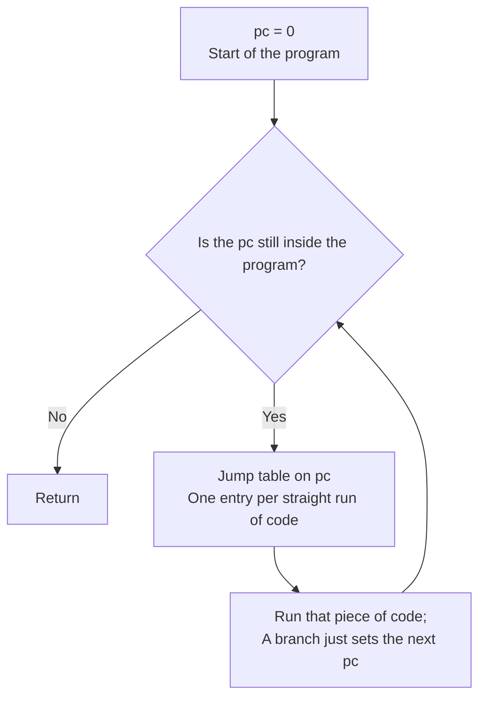

# SASS translator

The Switch 2's GPU runs NVIDIA machine code called SASS, which an Intel or AMD card cannot run. The translator rewrites each SASS program into SPIR-V, the shader format every Vulkan driver accepts. For example, `FADD R0, R1, R2` becomes "load the source registers from an array, add them as floats, store the sum".

## How are instructions decoded?

A generator reads the instruction table NVIDIA's disassembler, nvdisasm, carries, and writes the decoder as Rust code. Each row of that table, an encoding class, becomes one branch of the decoder. Each branch calls a handler, the function that emits SPIR-V for one instruction family.

| Decoder fact | Value |
|---|---|
| Instruction word | 128 bits, scheduling bits included |
| Decoder key | Bit 91 plus bits 11:0 |
| Generator | `scripts/decoder_generator.rs` reads `scripts/sm_86_instructions.txt` |
| Output | `sm86_decoder_generated.rs` |
| Alternate-syntax classes | Skipped, so a shorthand never hides the real instruction |
| Unknown word | Panics |

Why the SM86 table works for the Switch 2: NVIDIA's disassembler ships byte-identical tables for the desktop chip and the Switch 2 chip. See [ADR-0007](../adr/0007-t239-decodes-with-the-sm86-table.md).

## Where does the guest's state live?

SPIR-V has no direct way to name a GPU's hardware registers. So each guest register becomes an entry in an array the shader owns. "Private" below means one copy per thread, and "Workgroup" means one copy shared by a group of threads.

| Guest state | Home in SPIR-V | Note |
|---|---|---|
| Registers R0 to R253, RZ | Private array of 32-bit words | RZ always reads zero |
| Predicates P0 to P6, PT | One Private word of bits | One-bit "run this?" flags; PT is always true |
| Uniform registers UR0 to UR62, UP | The same array, after the predicates | Values shared by a whole warp |
| Live flag | Last word of the array | Finished threads start past the end |
| pc, return addresses, BSSY tokens B0 to B15 | Private variables | The program position and the rejoin markers |
| Local memory | Private array | 4 KiB per thread |
| Shared memory | Workgroup array | 1 KiB per workgroup |
| Warp exchange, schedule slots | Workgroup arrays | Where threads swap values and vote |

## How do jumps work without goto?

*Guest jumps become one loop around a jump table.*

Vulkan only accepts structured control flow: nested loops and ifs, never a free jump. So a guest branch only stores the next program position, the pc. One loop around a switch then runs the piece of code at that pc.

Those pieces are basic blocks, runs of code with no jump in or out except at the ends. A block starts at the program start, at every jump target, after every branch and EXIT, at BSYNC and after BAR. A jump to an address held in a register (BRX, JMX, CALL) could land anywhere, so then every instruction starts a block. EXIT sets the pc past the end.

An instruction with a predicate, such as `@P0 FADD`, is wrapped in an if on that predicate. Uniform instructions check their uniform predicate instead.

## What happens when threads of a warp disagree?

A warp is the team of threads the chip runs in lockstep. When teammates take different branches, that is divergence. Most programs never need teammates to meet, so each thread runs its own loop freely.

Some instructions make teammates swap values or wait for each other: VOTE, SHFL, MATCH, REDUX, BAR, the tensor instructions, LDSM, MOVM and R2UR.OR. Programs with any of them run in turns. Each turn, the threads vote, the lowest waiting pc runs, and threads at other pcs skip the turn with their memory writes masked.

- Swapped values travel through a shared array, with a barrier before and after.
- BSSY gives each thread a token for where it should rejoin; BSYNC waits while a teammate holding the same token is still elsewhere.
- BAR counts arrivals per barrier and releases the threads once all have arrived.
- A program that can never make progress marks itself stuck, and the test harness panics.

Why turns: every thread of a group must reach a Vulkan barrier together. And on lavapipe, Vulkan's own subgroups are narrower than a warp, so they cannot stand in for one. See [ADR-0003](../adr/0003-uniform-workgroup-scheduling-for-divergence.md).

## Which slots does a shader read its data from?

A Vulkan shader cannot follow pointers to its data. It reads from numbered slots, called bindings, and the host plugs a buffer or image into each slot before the run. All slots sit in one group, descriptor set 0.

| Binding | Kind | Holds |
|---|---|---|
| 0 | Uniform buffer, small and read-only | oboromi's own helper values, never game data |
| 1 to 8 | Uniform buffers | The game's constant buffers 0 to 7, stored as `uvec4` arrays |
| 9 | Storage buffer, large and read-write | The window onto guest memory |
| 10, 11 | Storage buffers | Register values in and out, tests only |
| 12 and up | Texture and image slots | Textures and writable images, in the order the shader first uses them |

A constant buffer, or cbuf, is a small read-only table the game hands the shader, such as the camera matrix. Vulkan's std140 layout rule pads every uniform array element to a fixed width. A `uvec4` fills that width exactly, so nothing is wasted.

| Layout fact | Value |
|---|---|
| std140 array element | Padded to 16 bytes |
| `uvec4` | Four 32-bit words, 16 bytes | See [ADR-0001](../adr/0001-set-0-binding-abi.md).

## Which kinds of shader are supported?

| Stage | Translator form | Stage-only instructions |
|---|---|---|
| Compute | `Stage::Compute { local_size }` | None |
| Vertex | `Stage::Vertex` | ALD and AST, attribute load and store |
| Fragment | `Stage::Fragment { flat, screen_linear, depth }` | IPA, attribute interpolation |

How smoothly a value blends across a triangle comes from the pixel shader's header, the SPH, not from IPA. Attributes are named by address:

| Attribute | Address |
|---|---|
| Position | 0x70 |
| Generic attribute n | 0x80 + 16n |
| Instance id | 0x2f8 |
| Vertex id | 0x2fc |
| Front facing | 0x3fc |

## How much is covered?

| Measure | Count |
|---|---|
| Encoding classes decoded | 999 |
| Handler functions | 176 |
| Handlers left as named todos | 19 |
| Named sub-form todos inside implemented handlers | 13 |

Left out on purpose until something needs them, each with a named panic:

| Group | Instructions |
|---|---|
| Graphics-only data transport | ISBERD, ISBEWR, LDTRAM, OUT, PIXLD |
| Ray tracing | The six TTU instructions |
| Sparse tensor | GATHER, SCATTER, GENMETADATA, SPMETADATA, BITEXTRACT |
| Other | FOOTPRINT, SUQUERY, UCLEA, float atomics, ATOM ARRIVE, CAST and SAFEADD, BAR.SCAN, texture reads with implicit level of detail in compute |

Verified by: spirv-val, the Khronos SPIR-V checker, on every emitted module; nvdisasm on every hand-built instruction word; and the silicon scoreboards (see [verification](verification.md)).

Sources: scripts/decoder_generator.rs, core/src/gpu/sm86_decoder_generated.rs, core/src/gpu/sm86/{mod,access,memory,control,warp}.rs, PR #80 body.
