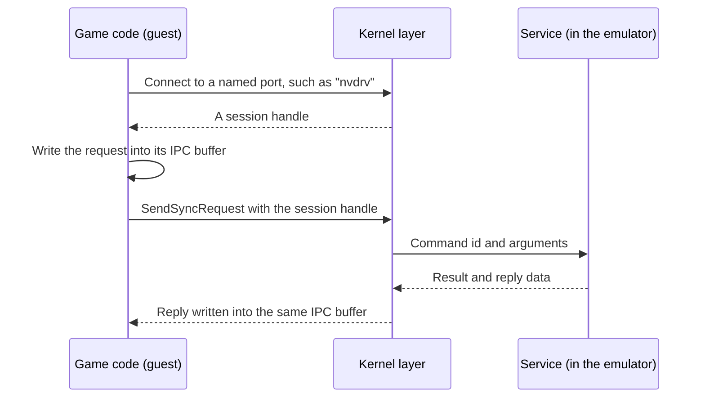

# Services

On the Switch, a game does not talk to hardware directly. It sends small messages to services, separate system programs that each own one job, such as the GPU driver or the display. For example, to get GPU memory a game opens a session with the GPU driver service and sends it a "create a buffer" message.

*How one request travels from a game to a service and back.*

## How does a game reach a service?

1. **Session.** The game asks the kernel to connect to a service by name. The kernel returns a handle, a number that names the open session.
2. **Message.** The game writes a request into its IPC buffer, a small per-thread area of memory. IPC means inter-process communication.
3. **Send.** The game calls `SendSyncRequest` with the session handle and waits.
4. **Reply.** The service writes its answer into the same buffer, and the call returns.

The message format is documented by switchbrew, the community's Switch wiki:

| Part of a request | What it holds |
|---|---|
| HIPC header | Message type and how many of each part follow |
| Special header, optional | A process-id placeholder and handles to pass along |
| Buffer descriptors | Addresses and sizes of guest memory the service may read or write |
| Raw data, aligned to 16 bytes | The `SFCI` magic, then the command id and its arguments |
| Reply raw data | The `SFCO` magic, then the result code and the outputs |

CMIF is the name for this command layer on top of HIPC. oboromi already defines the HIPC header types in `core/src/nn/hipc.rs`. The guest's encoder for the whole request lives in `guest/src/cmif.rs` on the `guest/scene-crate` branch.

## Which services exist?

The service registry names 160 services and gives each one a slot in the system state. Each entry is where that service's commands will go. The first ones being filled in are those a game needs to draw:

| Service | Job | State |
|---|---|---|
| `nvdrv` | The GPU driver: a table of open device files, each answering driver control calls (ioctls) | In progress: the guest-side calls and their layouts exist, the service is next |
| `nvmap`, via nvdrv | Describes GPU-visible memory allocations backed by guest RAM | In progress |
| `nvhost-as-gpu`, via nvdrv | The GPU address space: maps allocations to GPU addresses through the page map | In progress |
| `nvhost-gpu`, via nvdrv | A GPU channel: takes command lists and returns a completion fence | In progress |
| `nvhost-ctrl`, `nvhost-ctrl-gpu`, via nvdrv | Sync counters and the GPU's characteristics | In progress |
| `vi` | The display service: opens the display and a layer to show frames on | Planned |
| `IHOSBinderDriver` and `IGraphicBufferProducer` | Hand finished frames to the display, one buffer slot first | Planned |
| `audren`, `audout` | Audio, see [audio](audio.md) | Planned |

A fence is a sync counter value the game can wait on to know its work finished. Here the GPU work is done before the call returns, so the fence is already reached.

## What is documented, and what needs a Switch 2?

Switchbrew documents much of the Switch 2's service surface. Some parts can only be checked with a recording from a real console. The emulator labels each fact and never fills an unknown with Switch 1 behaviour.

| Fact | Status |
|---|---|
| The Switch 2 GPU driver interface `INvDrv2User` and its command numbers, including the new `SetConfiguration` | Documented |
| The GPU's characteristics: chip name `ga10f`, 3D class 0xC797, compute class 0xC7C0, 40 GPU address bits | Documented |
| New sync-counter and address-space ioctls on the Switch 2 | Documented by number; layouts need a capture |
| The display services are renamed to `vi2:v`, `vi2:m1`, `vi2:m2`, and `dispdrv` is gone | Documented |
| The command numbers of the new display services | Needs a Switch 2 capture |
| The GPU address ranges `GET_VA_REGIONS` returns | Needs a Switch 2 capture |
| The HIPC message format | Documented as unchanged |

The first milestone uses the Switch 1 layouts the community already documents, with the Switch 2 values where switchbrew gives them. Anything that cannot be verified stays marked unsupported.

Verified by: `ioctl_arguments_match_the_driver_layouts` on the `guest/scene-crate` branch checks the ioctl numbers and argument sizes against the documented driver layouts.

Sources: core/src/nn/mod.rs, core/src/nn/hipc.rs, guest/src/{cmif,nvdrv,svc}.rs on guest/scene-crate, switchbrew pages on HIPC, NV services and the Switch 2 services.
