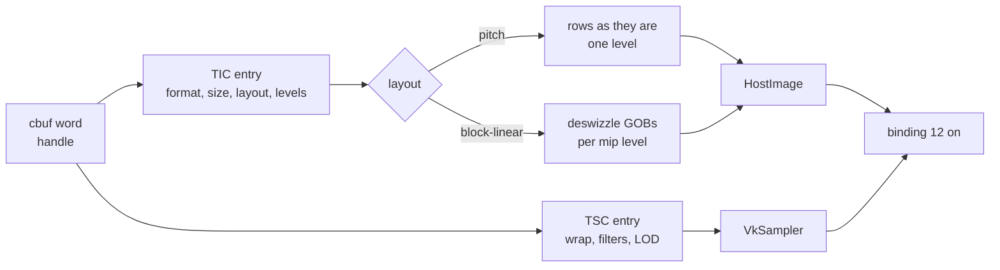

# Textures and tensors

Two families need more than a one-line lowering. Textures need the guest's descriptor pools decoded into Vulkan images and samplers. Tensor core ops need the exact way Ampere adds up products, which no Vulkan float operation reproduces.

## Textures

A texture handle is a word in a constant buffer: the low 20 bits index the TIC pool (texture headers), the top 12 bits index the TSC pool (samplers). The translator records where each handle comes from, `(cbuf bank, byte offset)`, and gives each distinct one a set-0 binding from 12. The host reads the handle, decodes both pool entries and binds an image with its sampler.

| decoded | supported |
|---|---|
| layouts | pitch-linear with one level, block-linear with a mip chain |
| formats | A8B8G8R8 UNORM and sRGB, R8, G8R8, R16G16B16A16 float, R32 UINT, BC1, BC3, BC7 |
| type and swizzle | 2D, identity swizzle |
| sampler | repeat or clamp to edge, nearest or linear, mip filter and LOD clamp |
| rejected by name | other formats, swizzles and types, depth compare, anisotropy, reduction filters, unnormalized TSC |

Block-linear: a GOB is 64 bytes by 8 rows with 16-byte sectors interleaved, GOBs stack into blocks along Y, and the block height shrinks per mip level as Ryujinx's size calculator does.

On the translator side: TEX, TLD, TLD4, TXD, TXQ and TMML sample through combined image samplers; SULD, SUST, SURED and SUATOM use storage images. TMML gets its derivatives from compute-shader derivative groups.

Why provenance, not handle values: the handle's source is known at translation time and its value is not. Unknown provenance fails by name.

## Tensor cores

HMMA, IMMA, DMMA, BMMA, LDSM and MOVM run per lane: lane 4g + t holds row g of a fragment, and each source register is shared through one warp exchange.

Silicon does not sum HMMA products in IEEE order. The model reproduced bit for bit:

| step | rule |
|---|---|
| grouping | products in groups of 8 k (4 for TF32), C joins the group sum |
| alignment | every term aligned to the largest exponent; a product's exponent is ea + eb |
| truncation | bits below 2^(emax-24) are dropped, not rounded |
| sum | exact integer sum, normalised to f32 by truncation |
| .F16 result | each group rounds to f16 |
| inf and NaN | an IEEE sum of only the special terms |

Why loops: written straight out, the exact model is a huge module that drivers take long to compile. A SPIR-V function was inlined back by both drivers. So operands are staged once in a Private array and the sum runs in four `DontUnroll` loops. See [ADR-0005](../adr/0005-hmma-exact-accumulation-as-dontunroll-loops.md).

per HMMA.16816.F32, cold pipeline compile:

| form | SPIR-V words | Intel | lavapipe |
|---|---|---|---|
| IEEE order, unrolled | 3.1k | 18 ms | 0.8 s |
| exact model, unrolled | 15.8k | 0.6 to 1 s | 2.5 s |
| exact model, one function | 3.1k | 940 ms | 6.0 s |
| exact model, DontUnroll loops | 4.9k | 57 ms | 0.2 s |

Verified by: the tensor silicon scoreboard (session 5 captures) passing on Intel and lavapipe, texture and surface captures from CUDA texture objects, and the block-linear swizzle checked against the Python asset converter.

Sources: core/src/gpu/texture.rs, core/src/gpu/sm86/{texture,tensor}.rs, core/src/tests/gpu/{texture,tensor}.rs, design note "texture ABI", project notes on HMMA numerics, loop form and block-linear textures.
