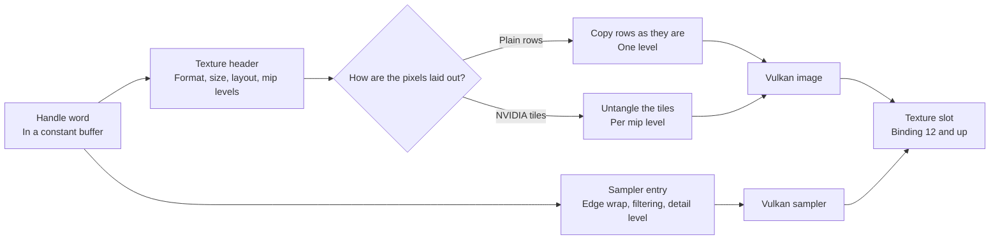

# Textures and tensors

Some instructions need more than a direct rewrite. Texture reads need the game's own image descriptions turned into Vulkan images. Tensor core instructions, which multiply small matrices in one go, need Ampere's exact way of adding numbers, which no Vulkan float operation copies. For example, adding the same products in a different order can change the last bit, and the tests compare every bit.

## Textures

### How does a shader find its texture?

A texture is an image a shader reads with filtering, and a sampler holds the reading settings, such as edge wrapping. A game describes both in tables in guest memory, called pools. The TIC pool holds texture headers (format, size, layout, address) and the TSC pool holds sampler entries.

The shader picks one entry from each pool with a handle, one word stored in a constant buffer (cbuf). The translator records where each handle comes from, as a cbuf bank and byte offset. Each distinct source gets its own Vulkan slot, a binding, numbered upwards from 12. Before the run, the host reads the handle, decodes both pool entries, and plugs in a Vulkan image with its sampler.

| Handle bits | Picks |
|---|---|
| Low 20 | The TIC entry, the texture |
| Top 12 | The TSC entry, the sampler |

*How one handle word becomes a Vulkan image and sampler in a shader slot.*

### Which textures are supported?

| Decoded | Supported |
|---|---|
| Layouts | Plain rows (pitch-linear) with one level; NVIDIA tiles (block-linear) with a chain of mip levels |
| Formats | A8B8G8R8 UNORM and sRGB, R8, G8R8, R16G16B16A16 float, R32 UINT, compressed BC1, BC3, BC7 |
| Type and channel order | 2D, channels in their normal order |
| Sampler | Repeat or clamp to edge, nearest or linear filtering, mip filter and detail clamp |
| Rejected by name | Other formats, channel orders and types, depth compare, anisotropy, reduction filters, unnormalized sampler coordinates |

A mip level is a smaller copy of the texture, used when it is far away. sRGB is a colour encoding that matches how screens show brightness.

### What is a block-linear texture?

Block-linear is NVIDIA's tiled layout. It keeps pixels that are close on screen close in memory, which makes reads faster. The tiles are GOBs, groups of bytes, and GOBs stack into taller blocks. The decoder untangles the tiles back into rows.

| Block-linear fact | Value |
|---|---|
| GOB size | 64 bytes wide, 8 rows high |
| Inside a GOB | 16-byte pieces, interleaved |
| Blocks | GOBs stacked along Y |
| Block height per mip level | Shrinks as the level shrinks, the way Ryujinx's size calculator does |

### Which instructions read textures?

| Instructions | Vulkan form |
|---|---|
| TEX, TLD, TLD4, TXD, TXQ, TMML: sampled reads and queries | Combined image samplers |
| SULD, SUST, SURED, SUATOM: pixel loads, stores and atomics | Storage images |

TMML asks which mip level a read would use. In compute it gets its slopes from Vulkan's compute-shader derivative groups.

Why record where the handle comes from, not its value: the source is known when translating, but the value is only known at run time. A handle whose source cannot be traced fails by name.

## Tensors

### How are matrix instructions run?

Tensor core instructions (HMMA, IMMA, DMMA, BMMA, LDSM and MOVM) compute `D = A × B + C` on small matrices. The matrices are spread across a warp, the team of threads that runs in lockstep. Each thread holds a few elements, its matrix fragment. The translator runs them per thread and shares each input register through one exchange array.

| Layout fact | Value |
|---|---|
| Which thread holds what | Thread 4g + t holds row g of a fragment |
| Sharing | Each source register goes through one warp exchange |

### How does the chip add the products?

Standard float maths adds one number at a time and rounds after each step. The real chip does not sum HMMA products that way. The translator reproduces its method bit for bit:

| Step | Rule |
|---|---|
| Grouping | Products in groups of 8 along k (4 for TF32); C joins the group sum |
| Alignment | Every term is lined up to the largest exponent; a product's exponent is ea + eb |
| Truncation | Bits below 2^(emax-24) are dropped, not rounded |
| Sum | Exact integer sum, turned back into f32 by truncation |
| .F16 result | Each group rounds to f16 |
| Inf and NaN | Standard float rules, applied to only the special terms |

### Why is the sum written as loops?

Written straight out, the exact method makes a huge shader that drivers take long to compile. Putting it in one SPIR-V function did not help, because both drivers pasted it back into every caller. So the inputs are loaded once into a per-thread array. The sum runs in loops marked `DontUnroll`, a hint that tells the driver to keep each loop as a loop. See [ADR-0005](../adr/0005-hmma-exact-accumulation-as-dontunroll-loops.md).

Per HMMA.16816.F32, cold pipeline compile:

| Form | SPIR-V words | Intel | lavapipe |
|---|---|---|---|
| Standard float order, unrolled | 3.1k | 18 ms | 0.8 s |
| Exact method, unrolled | 15.8k | 0.6 to 1 s | 2.5 s |
| Exact method, one function | 3.1k | 940 ms | 6.0 s |
| Exact method, four DontUnroll loops | 4.9k | 57 ms | 0.2 s |

Verified by: the tensor silicon scoreboard, recordings from a real card, passing on Intel and lavapipe; texture and image recordings from CUDA texture objects; and the block-linear untangling checked against the Python asset converter.

Sources: core/src/gpu/texture.rs, core/src/gpu/sm86/{texture,tensor}.rs, core/src/tests/gpu/{texture,tensor}.rs.
