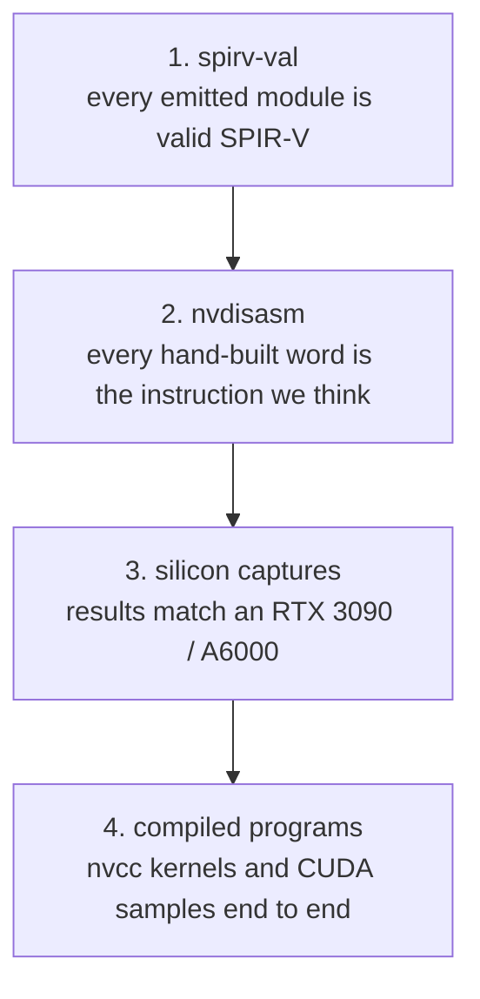

# Verification

Every claim about the GPU work rests on one of four tiers, cheapest first. A handler is not done until it passes the tiers that apply to it, on Intel and on lavapipe.

| tier | how | where |
|---|---|---|
| spirv-val | the harness pipes each module through `spirv-val`, skipped when it is not installed | core/src/tests/gpu/harness.rs |
| nvdisasm | `fixtures_match_nvdisasm` disassembles the test words and compares the text | core/src/tests/gpu_test.rs |
| silicon | scoreboard tests replay captured inputs and compare registers, shared, global and image bytes | core/src/tests/gpu/fixtures.rs, core/tests/fixtures |
| programs | nvcc-built kernels run through the translator and match silicon output or its hash | core/src/tests/gpu/program.rs, cubin tests |

## How silicon captures are made

Each capture patches one 128-bit instruction word into an nvcc-compiled seed kernel, launches it through the CUDA driver API on a rented RTX 3090 or A6000, and reads the registers and memory back. Words are built from the instruction table and checked with nvdisasm before launch. A fixture records the word, inputs, outputs and whether it was really observed; observed results are never hand-written.

| session | device | what it added |
|---|---|---|
| 1 | RTX 3090 | single-instruction integer cases |
| warp | RTX A6000 | votes, shuffles, reductions, shared memory, barriers |
| 3 | RTX 3090 | fp32, fp16, fp64, conversions, predicates, warp, textures |
| 4 | RTX 3090 | whole programs, DSETP, HSETP2, atomics, textures |
| 5 | RTX 3090 | observers, local memory, TMML, SUATOM, tensors, driver cbuf0 values |

| fixture file | captures |
|---|---|
| sm86-thread.jsonl | 136 |
| sm86-predicate.jsonl | 209 |
| sm86-warp.jsonl | 220 |
| sm86-texture.jsonl | 37 |
| sm86-observer.jsonl | 31 |
| sm86-tensor.jsonl | 15 |

Known failures are named per fixture id and per device, each with its reason: `KNOWN_FAILURES` hold everywhere (MUFU.TANH is a hardware approximation, SUATOM lane order is up to the device), `LLVMPIPE_FAILURES` only on lavapipe (f64 RoundEven truncates, an infinite unnormalized coordinate reads texel 0). See [ADR-0008](../adr/0008-silicon-first-verification.md).

## What each tier caught

| bug | caught by |
|---|---|
| EXIT emitted OpKill, which compute shaders may not use | spirv-val |
| vector types read type id 0, OpMemberName in the wrong section | spirv-val |
| MOV immediate keyed on 0x1a02, which is really MOV from cx[UR]; the real key is 0x802 | nvdisasm |
| test words carried guard P0 instead of PT | nvdisasm |
| drivers folded `x + -x` to zero, Intel flushed f16 and f64 denormals | fp32 tests, then silicon fp16 and fp64 cases |
| NaN results: fp32 and fp16 are canonical, fp64 keeps the first NaN's payload | silicon |
| HMMA summed in IEEE order instead of the truncating group sum | silicon tensor captures |
| SHFL with a clamp of 15 was read as a half-warp segment; it clamps the whole warp | silicon, a later session |
| LDG/STG with a memory descriptor added the descriptor to the address | compiled program (nvcc mul-add) |
| I2F to f32 ignored directed rounding | CUDA sample (Mandelbrot) |
| IADD3 ignored the negate bit on cbuf and uniform operands | CUDA sample (Mandelbrot) |
| IMAD.HI added Rc as 32 bits instead of the 64-bit pair | CUDA sample (Mandelbrot) |
| narrow stores raced as a plain read-modify-write | review; now a compare-exchange loop |
| HFMA2 rounded twice through native f16 fma on lavapipe | review; now one rounding from a round-to-odd f32 sum |
| BAR.RED wrote its result to Rb instead of B2R.RESULT | divergence work |

The lesson in the last group: whole compiled programs find bugs the per-instruction captures miss, in operand flags, rounding modes and register pairs.

## Perf and CI

`core/examples/perf.rs` prints p50, p95, p99 and max for translate, dispatch, draw, the demo frames and the pushbuffer triangle. `scripts/profile.sh` records it with perf and writes a report and a flamegraph. CI builds and tests on Ubuntu, Windows and macOS; only Ubuntu has a Vulkan device (lavapipe), the others skip the GPU tests. Ubuntu also prints the perf baseline.

Verified by: this page is the index of checks; each tier's tests are listed above.

Sources: core/src/tests/gpu/{harness,fixtures,program}.rs, core/src/tests/gpu_test.rs, core/tests/fixtures/README, core/examples/perf.rs, scripts/profile.sh, .github/workflows/ci.yml.
