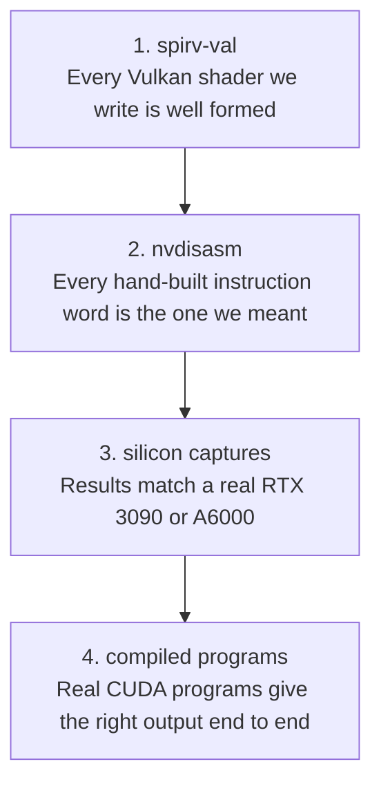

# Verification

Each translated instruction has to prove it behaves like the real chip. The strongest proof is running the instruction on a real Ampere card and comparing every output byte. For example, one instruction runs on a rented RTX 3090 with known inputs. The translated version must then give the same bits on Intel and on lavapipe.

## Which checks exist?

*The checks, from cheapest to most convincing.*

A handler, the code that translates one instruction family, is not done until it passes every check that applies. It must pass on Intel and on lavapipe, Mesa's CPU-based Vulkan driver.

| Check | How | Where |
|---|---|---|
| spirv-val, the Khronos SPIR-V checker | The harness pipes each module through it, skipped when it is not installed | Core/src/tests/gpu/harness.rs |
| nvdisasm, NVIDIA's disassembler | `fixtures_match_nvdisasm` disassembles the test words and compares the text | Core/src/tests/gpu_test.rs |
| Silicon | Scoreboard tests replay recorded inputs and compare registers, shared memory, global memory and image bytes | Core/src/tests/gpu/fixtures.rs, core/tests/fixtures |
| Programs | Kernels built with nvcc, NVIDIA's CUDA compiler, run through the translator and must match the card's output or its hash | Core/src/tests/gpu/program.rs, cubin tests |

## How are silicon captures made?

A capture patches one instruction word into a small compiled CUDA program, the seed kernel. It runs that program on a rented card through the CUDA driver and reads the registers and memory back. The word is built from the instruction table and checked with nvdisasm before the run.

The result is stored as a fixture: the word, the inputs, the outputs, and whether the result was really observed. Observed results are never typed in by hand.

| Session | Card | What it added |
|---|---|---|
| 1 | RTX 3090 | Single-instruction integer cases |
| Warp | RTX A6000 | Votes, shuffles, reductions, shared memory, barriers |
| 3 | RTX 3090 | fp32, fp16, fp64, conversions, predicates, warp, textures |
| 4 | RTX 3090 | Whole programs, DSETP, HSETP2, atomics, textures |
| 5 | RTX 3090 | Observers, local memory, TMML, SUATOM, tensors, the driver's constant buffer 0 values |

| Fixture file | Captures |
|---|---|
| sm86-thread.jsonl | 136 |
| sm86-predicate.jsonl | 209 |
| sm86-warp.jsonl | 220 |
| sm86-texture.jsonl | 37 |
| sm86-observer.jsonl | 31 |
| sm86-tensor.jsonl | 15 |

## What if a result is allowed to differ?

Each allowed mismatch is listed by fixture id, with its reason, for every device or for lavapipe only. Any other mismatch fails the test. See [ADR-0008](../adr/0008-silicon-first-verification.md).

| List | Applies to | Examples |
|---|---|---|
| `KNOWN_FAILURES` | Every device | MUFU.TANH is a hardware approximation; SUATOM's thread order is up to the device |
| `LLVMPIPE_FAILURES` | lavapipe only | f64 round-to-even truncates; an infinite unnormalized coordinate reads texel 0 |

## What did each check catch?

| Bug | Caught by |
|---|---|
| EXIT emitted OpKill, which compute shaders may not use | spirv-val |
| Vector types read type id 0, OpMemberName in the wrong section | spirv-val |
| MOV immediate keyed on 0x1a02, which is really MOV from cx[UR]; the real key is 0x802 | nvdisasm |
| Test words carried guard P0 instead of PT | nvdisasm |
| Drivers folded `x + -x` to zero, Intel flushed tiny f16 and f64 values | fp32 tests, then silicon fp16 and fp64 cases |
| NaN results: fp32 and fp16 are canonical, fp64 keeps the first NaN's payload | Silicon |
| HMMA summed in standard float order instead of the truncating group sum | Silicon tensor captures |
| SHFL with a clamp of 15 was read as a half-warp segment; it clamps the whole warp | Silicon, a later session |
| LDG/STG with a memory descriptor added the descriptor to the address | Compiled program (nvcc mul-add) |
| I2F to f32 ignored directed rounding | CUDA sample (Mandelbrot) |
| IADD3 ignored the negate bit on cbuf and uniform operands | CUDA sample (Mandelbrot) |
| IMAD.HI added Rc as 32 bits instead of the 64-bit pair | CUDA sample (Mandelbrot) |
| Narrow stores raced as a plain read-modify-write | Review; now a compare-exchange loop |
| HFMA2 rounded twice through native f16 fma on lavapipe | Review; now one rounding from a round-to-odd f32 sum |
| BAR.RED wrote its result to Rb instead of B2R.RESULT | Divergence work |

The lesson from the CUDA sample rows: whole programs find bugs that single-instruction captures miss. They hit operand flags, rounding modes and register pairs together.

## How are speed and CI checked?

`core/examples/perf.rs` prints latency percentiles for translate, dispatch, draw, the demo frames and the pushbuffer triangle. `scripts/profile.sh` records it with perf and writes a report and a flamegraph.

| CI runner | GPU tests |
|---|---|
| Ubuntu | Run on lavapipe, then print the perf baseline |
| Windows | Skipped, no Vulkan device |
| macOS | Skipped, no Vulkan device |

Verified by: this page is the index of checks; each check's tests are listed above.

Sources: core/src/tests/gpu/{harness,fixtures,program}.rs, core/src/tests/gpu_test.rs, core/tests/fixtures/README, core/examples/perf.rs, scripts/profile.sh, .github/workflows/ci.yml.
