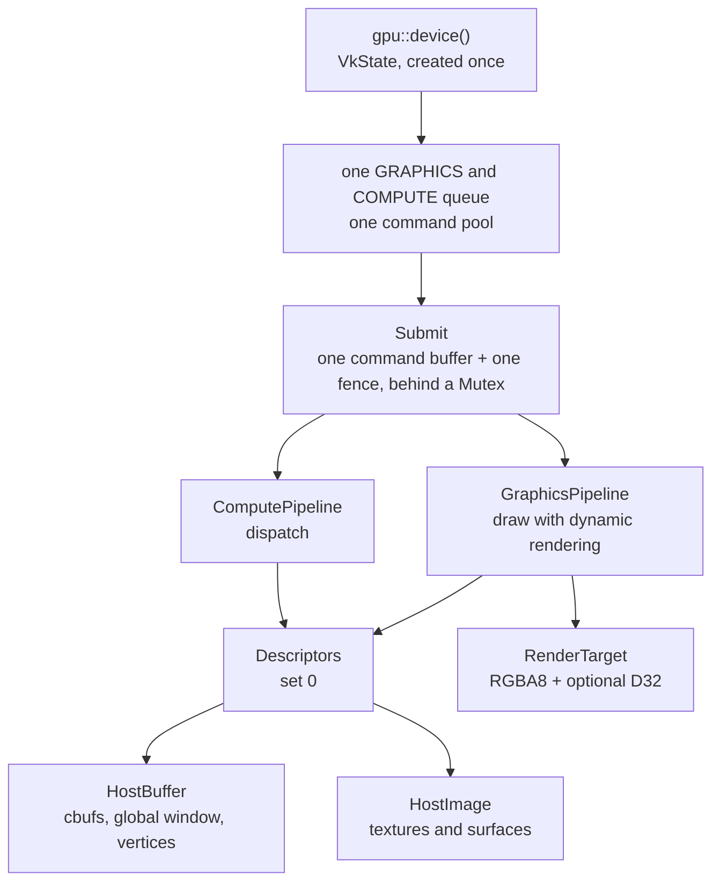

# Vulkan backend

The backend owns one Vulkan device and runs everything synchronously on one queue: compute dispatches for translated compute programs and CUDA kernels, graphics draws for the engine. Every submit waits on a fence and reads results back to host memory before it returns.

## Parts

| part | file | role |
|---|---|---|
| `VkState` | gpu/mod.rs | instance, physical device, device, queue, pool, feature flags |
| `HostBuffer` | gpu/compute.rs | host-visible buffer, cached memory preferred, explicit flush and invalidate |
| `HostImage` | gpu/compute.rs | 2D image uploaded through staging with all its mip levels, kept in GENERAL |
| `Descriptors` | gpu/compute.rs | the set-0 layout shared by compute and graphics |
| `ComputePipeline` | gpu/compute.rs | compute pipeline; `VkState::dispatch` records, barriers, submits, waits |
| `GraphicsPipeline` | gpu/graphics.rs | vertex + fragment pipeline for one colour format and optional depth |
| `RenderTarget` | gpu/graphics.rs | offscreen colour and depth images, read back after each draw |

## Device choices

| choice | why |
|---|---|
| Vulkan 1.3, first device with a GRAPHICS and COMPUTE queue | dynamic rendering without render pass objects |
| shaderFloat16, shaderFloat64, shaderInt64 when present | fp16, fp64 and 64-bit integer SASS ops |
| int64 buffer and shared atomics when present | 64-bit ATOM and ATOMS; Intel lacks the shared one |
| VK_KHR_compute_shader_derivatives, linear groups | TMML and derivatives in compute programs |
| SignedZeroInfNanPreserve and DenormPreserve per width | drivers fold `x + -x` to zero and Intel flushes f16 and f64 denormals; the guest does neither |
| a missing ICD maps to `NoDevice` | tests skip cleanly on machines without Vulkan |

Dynamic state, so one pipeline serves every value: viewport, scissor, cull mode, front face, primitive topology within its class, depth test, depth write, depth compare and blend constants. The pipeline key keeps only what Vulkan cannot change at draw time: shader hashes, vertex layout, topology class, colour write mask and the depth attachment.

## Latency rules

- No allocation per frame: the device is a process-wide singleton, the command buffer and fence are reused, demo pipelines are built once and kept in a static.
- Cached host memory for readback, since reads from uncached memory are slow.
- The engine caches modules by SPH and code hash, pipelines by key, buffer mirrors by guest-physical ranges, and refreshes a mirror only when its pages changed.

measured on an Intel Arc (MTL), p50, `cargo run --release -p oboromi-core --example perf`:

| path | latency |
|---|---|
| translate 1000 instructions | 326 µs |
| dispatch, fence and readback | 135 µs |
| draw and readback, 64x64 triangle | 193 µs |
| 1080p test frame end to end | 4.2 ms |
| Julia demo frame end to end | 4.7 ms |
| pushbuffer triangle at 1080p | 6.6 ms |

## lavapipe as the CI device

The Ubuntu CI job installs mesa's lavapipe and spirv-tools, pins `VK_DRIVER_FILES` to the lavapipe ICD, runs the whole suite on it and then runs the perf example as a latency baseline. Every GPU test also runs locally on Intel. Where lavapipe differs from silicon, the fixture lists say so per device.

Verified by: the Vulkan validation layer clean on Intel and lavapipe for dispatch, draw and depth paths; the suite skipping without an ICD.

Sources: core/src/gpu/{mod,compute,graphics,engine}.rs, core/examples/perf.rs, .github/workflows/ci.yml, PR #79 body.
