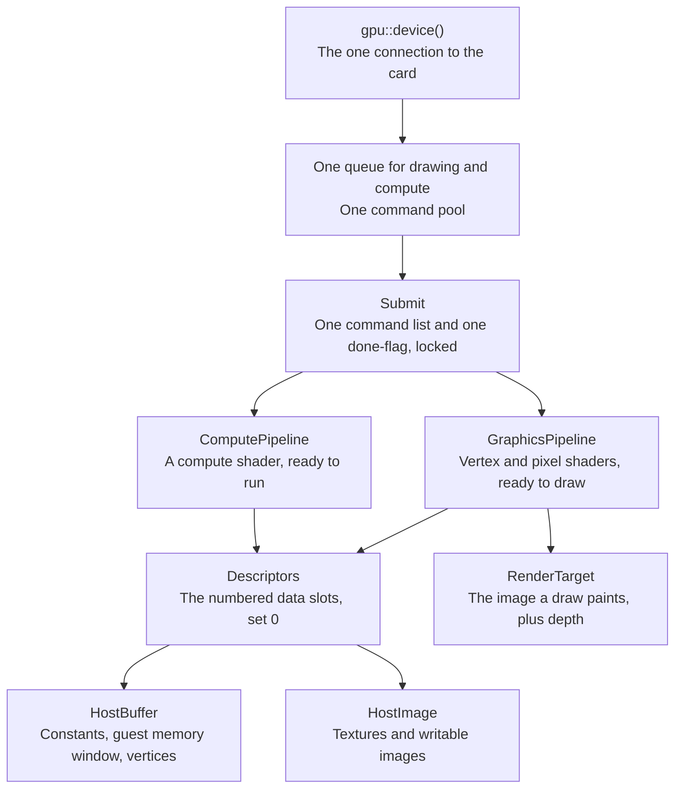

# Vulkan backend

The backend is the layer that drives the PC's graphics card through Vulkan. It opens the card once, uploads what a program needs, runs it, and copies the results back. For example, a compute run records one command list, submits it, waits until the card is done, and reads the output buffer.

*What the backend owns, from the device down to the buffers a shader reads.*

All work goes through one queue, the place work is handed to the card. Each submit uses one command buffer, a recorded list of card commands, and one fence, a flag the card raises when it finishes. Every submit waits on its fence and copies results to host memory before it returns.

## What are the parts?

| Part | File | Role |
|---|---|---|
| `VkState` | gpu/mod.rs | The Vulkan instance, the chosen card, its queue and command pool, and which optional features it has |
| `HostBuffer` | gpu/compute.rs | A buffer the CPU can read and write; cached memory preferred, flushed and refreshed explicitly |
| `HostImage` | gpu/compute.rs | A 2D image with all its mip levels (smaller copies), uploaded through a staging buffer |
| `Descriptors` | gpu/compute.rs | The layout of numbered data slots, shared by compute and drawing |
| `ComputePipeline` | gpu/compute.rs | A compiled compute shader; `VkState::dispatch` records, submits and waits |
| `GraphicsPipeline` | gpu/graphics.rs | Compiled vertex and pixel shaders for one colour format, with optional depth |
| `RenderTarget` | gpu/graphics.rs | Offscreen colour and depth images, read back after each draw |

## Which card features does it ask for?

| Choice | Why |
|---|---|
| Vulkan 1.3, the first card with a queue for both drawing and compute | Dynamic rendering: drawing straight into images without render pass objects |
| 16-bit and 64-bit floats, 64-bit integers, when present | SASS has instructions on all of these |
| 64-bit atomics on buffers and shared memory, when present | For SASS's 64-bit ATOM and ATOMS; Intel lacks the shared-memory one |
| Compute shader derivatives | TMML, which asks which mip level a texture read would use, needs them in compute |
| Keep signed zeros, infinities, NaNs and denormals at every float width | Drivers fold `x + -x` to zero and Intel flushes tiny floats to zero; the Switch 2's GPU does neither |
| No Vulkan driver found means `NoDevice` | Tests skip cleanly on machines without Vulkan |

## Which settings can change per draw?

A Vulkan pipeline is a compiled bundle of shaders and settings. Building one is slow, so oboromi keeps as much as possible as dynamic state, settings changed per draw for free.

| Kind | Settings |
|---|---|
| Dynamic, changed per draw | Viewport, scissor, cull mode, front face, triangle or line type within its group, depth test, depth write, depth compare, blend constants |
| Fixed, part of the pipeline key | Shader hashes, vertex layout, primitive group, colour write mask, depth image present |

## How does it stay fast?

- Nothing is allocated per frame. The card connection is created once per process, the command buffer and fence are reused, and demo pipelines are built once.
- Results are read from cached host memory, because reading uncached memory is slow.
- The engine caches translated shaders by content, pipelines by key, and buffer copies by guest memory range. A copy refreshes only when its memory changed.

Measured on an Intel Arc (MTL), p50, `cargo run --release -p oboromi-core --example perf`:

| Path | Latency |
|---|---|
| Translate 1000 instructions | 326 µs |
| Dispatch, fence and readback | 135 µs |
| Draw and readback, 64x64 triangle | 193 µs |
| 1080p test frame end to end | 4.2 ms |
| Julia demo frame end to end | 4.7 ms |
| Pushbuffer triangle at 1080p | 6.6 ms |

## Why does CI run on lavapipe?

Mesa's lavapipe is a Vulkan driver that runs on the CPU, so CI needs no graphics card. The Ubuntu CI job installs lavapipe and the SPIR-V tools and points Vulkan at lavapipe. It runs the whole suite, then prints the perf numbers as a baseline. Every GPU test also runs locally on Intel. Where lavapipe differs from the real chip, the test fixtures list the difference for that device.

Verified by: the Vulkan validation layer, a debug layer that reports API misuse, clean on Intel and lavapipe for dispatch, draw and depth; and the suite skipping without a Vulkan driver.

Sources: core/src/gpu/{mod,compute,graphics,engine}.rs, core/examples/perf.rs, .github/workflows/ci.yml, PR #79 body.
