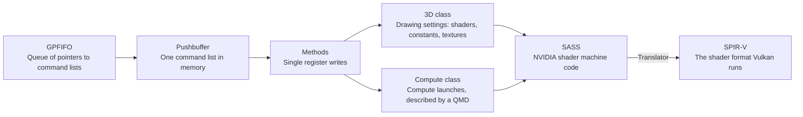

# Glossary

A game talks to its GPU through command words in memory and small programs called shaders. Each piece on that path has its own name. For example, to draw a triangle the game writes a command list and points the GPU at it. The GPU then runs a shader for every covered pixel.

*How a game's commands lead to shader code a PC's GPU can run.*

## Chips and code formats

| Term | What it is | Example |
|---|---|---|
| GPU | The graphics chip: many small cores running the same program on many pixels or numbers at once. | Shading every pixel of a frame in parallel. |
| Guest, host | The guest is the emulated Switch 2 and its memory; the host is the PC running oboromi. | A guest address points into emulated console RAM. |
| Shader | A small program the GPU runs once per vertex, pixel or work item. | A pixel shader that returns one pixel's colour. |
| SASS | NVIDIA's native GPU machine code, the instructions the chip really executes. | `FADD R0, R1, R2` adds two floats; on SM86 each instruction is a 128-bit word. |
| SM86 | The instruction set of NVIDIA's Ampere desktop chips, which the Switch 2 also uses. | An RTX 3090 runs SM86 code. |
| SM88 | CUDA's name for the Switch 2 GPU's instruction set; its encoding table equals SM86's. | `nvdisasm --binary SM88` decodes Switch 2 code. |
| Ampere | NVIDIA's GPU generation shared by desktop cards and the Switch 2. | RTX 30 series cards are Ampere. |
| T239 | The Switch 2's system-on-chip: ARM CPU cores plus an Ampere GPU called GA10F. | The main chip inside every Switch 2. |
| GA102 | The desktop Ampere chip the reference results are recorded on. | RTX 3090 and RTX A6000 are GA102 cards. |
| Silicon | Real hardware, as opposed to an emulator or a CPU-based driver. | "matches silicon" means an RTX 3090 gave the same bytes. |
| SPIR-V | The binary shader format Vulkan accepts, like bytecode for GPUs. | The translator writes one SPIR-V module per guest program. |
| Module | One SPIR-V program, ready to hand to a Vulkan driver. | The translated Julia demo shader. |
| Translator | oboromi's code that rewrites SASS into SPIR-V. | `core/src/gpu/sm86`. |
| Encoding class | One row of NVIDIA's instruction table: a bit pattern plus its fields. | An add with a register operand and one with a constant are two classes. |
| Handler | The translator function that emits SPIR-V for one instruction family. | The FADD handler emits a float add. |
| Opcode | The name of an instruction. | `IMAD` is integer multiply-add. |

## How commands reach the GPU

| Term | What it is | Example |
|---|---|---|
| Channel | One stream of commands from a program to the GPU. | A game's renderer usually owns one. |
| GPFIFO | A ring of small entries, each pointing at a pushbuffer and giving its length. | The game appends one entry per batch of commands. |
| Pushbuffer | A list of 32-bit command words in guest memory: a header word, then data words. | "set viewport width to 1920" is one header and one data word. |
| Method | One register write to a GPU engine, named by its register offset. | Writing the vertex count before a draw. |
| Class | A GPU engine's set of registers, identified by a number. | 0xC797 is the Ampere 3D engine, 0xC7C0 compute, 0xC76F the channel. |
| Subchannel | One of eight slots a channel binds a class into, so each header can pick an engine. | Subchannel 0 holds the 3D class after `SET_OBJECT`. |
| `SET_OBJECT` | The channel method that binds a class to a subchannel. | Sent once at the start of a command stream. |
| Draw trigger | The method write that means "draw now with the current settings". | `DRAW_VERTEX_ARRAY_BEGIN_END_INSTANCE_FIRST`. |
| Snapshot | A frozen copy of the GPU settings at the moment of a draw or launch. | `DrawSnapshot` holds the viewport the draw used. |
| Semaphore | A memory word the GPU writes or waits on, to tell the CPU how far it got. | A release writes a counter when a frame is done. |
| Syncpoint | The Switch's hardware counter for the same job, managed by the OS. | The display waits on one before showing a frame. |
| Report | A value the GPU writes to memory on request. | A counter or timestamp after a draw. |
| MME, MME64 | A small macro processor in the GPU that expands one call into many method writes. | One macro call that sets up a whole draw. |
| QMD | Queue meta data: a block in guest memory describing one compute launch. | Grid size, threads per group, program address, constant buffers. |
| Dispatch | One compute launch: run a program over a grid of threads. | One dispatch per frame of the Julia demo. |

## Shaders and their data

| Term | What it is | Example |
|---|---|---|
| Stage | Which step of drawing a shader belongs to. | Vertex, fragment or compute. |
| Vertex shader | Runs once per corner of a triangle and computes where it lands on screen. | Multiplying a position by the camera matrix. |
| Fragment shader | Runs once per covered pixel and computes its colour; also called a pixel shader. | Sampling a texture and returning the colour. |
| Compute shader | A shader not tied to drawing, run over a grid of threads for general work. | The Julia set demo. |
| SPH | Shader program header: a block before a graphics program naming its stage, inputs and outputs. | "vertex stage, writes position and one colour". |
| IMAP, OMAP | The SPH's input and output maps: which attributes a shader reads and writes. | OMAP bit for "writes generic attribute 0". |
| Attribute | A per-vertex value passed between stages. | Position, colour or texture coordinate. |
| Interpolation | Blending a vertex value across a triangle's pixels; "flat" means no blending. | A colour fading from one corner to another. |
| cbuf | Constant buffer: a small read-only table of numbers the game hands the shader. | The camera matrix, read as `c[bank][offset]`. |
| Bank | Which of a shader's constant buffers an access names. | Bank 0 carries launch data in compute, such as the grid size. |
| Global memory | The GPU's view of main memory, read and written by address. | `LDG` loads from it, `STG` stores to it. |
| Shared memory | A small fast scratch area shared by the threads of one workgroup. | Threads swapping partial sums. |
| Local memory | Per-thread scratch memory for values that do not fit in registers. | A large per-thread array. |
| Register | A named per-thread variable inside the GPU core. | `R0` to `R253`; `RZ` always reads zero. |
| Predicate | A one-bit register that decides whether an instruction runs. | `@P0 FADD` adds only where `P0` is true. |
| Uniform datapath | Per-warp registers holding one value shared by all its threads. | `UR0` to `UR62` and predicates `UP0` to `UP6`. |
| pc | Program counter: the position of the next instruction. | A branch sets the pc to its target. |
| Basic block | A run of instructions entered only at the top and left only at the bottom. | The body of a loop without inner branches. |
| Attribute space | The address range an instruction uses to name an attribute. | Position sits at 0x70. |

## How the GPU runs threads

| Term | What it is | Example |
|---|---|---|
| Thread, invocation, lane | One running copy of a shader; Vulkan says invocation, and a lane is a thread's slot in a warp. | The thread shading one pixel. |
| Warp | A team of threads that runs one instruction stream in lockstep. | NVIDIA warps are 32 threads. |
| Subgroup | Vulkan's name for a warp; its width depends on the device. | lavapipe's subgroups are 8 wide. |
| Workgroup | A group of threads that can share memory and wait for each other; CUDA calls it a block. | 256 threads working on one tile of an image. |
| Divergence | Threads of one warp taking different sides of a branch. | Pixels inside and outside a circle. |
| Reconvergence | The point where diverged threads join up again. | The end of an if-else. |
| BSSY, BSYNC | The SM86 instruction pair marking where diverged threads of a warp join again. | `BSSY` before an if, `BSYNC` after it. |
| Barrier | A point every thread of a group must reach before any goes on. | `BAR` before reading what others wrote to shared memory. |
| Collective | An instruction where threads of a warp exchange values. | `VOTE` asks which threads have a condition; `SHFL` reads a teammate's register. |
| Structured control flow | SPIR-V's rule that branches must form nested loops and ifs, with no free jumps. | No `goto` into the middle of a loop. |

## Textures

| Term | What it is | Example |
|---|---|---|
| Texture | An image a shader reads with filtering. | A brick wall image on a model. |
| Sampler | The settings for reading a texture: edge wrapping, filtering, level of detail. | Repeat at the edges, smooth between pixels. |
| TIC | Texture image control: a header describing one texture's format, size, layout, address and mip levels. | One 32-byte entry per texture. |
| TSC | Texture sampler control: an entry holding one sampler's settings. | One 32-byte entry per sampler. |
| Pool | A table of TIC or TSC entries in guest memory. | A game's texture pool with hundreds of headers. |
| Handle | A cbuf word that picks one TIC entry and one TSC entry. | Low 20 bits pick the texture, top 12 bits the sampler. |
| Mip level | A smaller copy of the same texture, used when it appears far away. | A 512 pixel texture with 256, 128 and smaller copies. |
| LOD | Level of detail: which mip level a read uses. | LOD 0 is full size. |
| Format | How a pixel's bytes are laid out. | `A8B8G8R8` is four 8-bit channels; `BC1`, `BC3`, `BC7` are compressed. |
| sRGB | A colour encoding matching how screens show brightness, decoded to linear before maths. | Most photos and base-colour textures. |
| Pitch-linear | Plain rows of pixels, one after another. | A screenshot in memory. |
| Block-linear | NVIDIA's tiled layout that keeps nearby pixels close in memory. | Most textures a game uploads. |
| GOB | Group of bytes: the small tile block-linear layouts are built from. | 64 bytes wide and 8 rows high. |
| Deswizzle | Reorder tiled pixels back into plain rows. | Turning a block-linear texture into a Vulkan image. |
| Surface | An image a shader writes pixel by pixel instead of sampling; Vulkan calls it a storage image. | `SUST` stores one pixel. |
| Render target | The image a draw writes its pixels into. | A colour image plus an optional depth image. |
| Depth | Per-pixel distance, used to hide what is behind. | A wall in front of a door. |

## Tensor cores

| Term | What it is | Example |
|---|---|---|
| Tensor core | A unit that multiplies small matrices in one instruction. | AI inference and upscaling use them. |
| HMMA, IMMA | Matrix multiply-accumulate on tensor cores, for half-precision floats and for integers. | One HMMA computes `D = A × B + C` across a warp. |
| DMMA, BMMA | The same for double-precision floats and for single bits. | DMMA for scientific maths. |
| LDSM, MOVM | Load and rearrange matrix pieces for tensor instructions. | Loading a tile from shared memory. |
| Matrix fragment | The part of a matrix one thread holds. | A few elements of row 3 of `A`. |
| TF32 | A reduced-precision float format tensor cores use for speed. | 32 bits of storage, fewer mantissa bits used. |
| Truncation | Dropping low bits instead of rounding them. | 1.27 truncated to one decimal is 1.2. |
| IEEE order | Adding numbers one at a time, rounding after each step, as standard float rules do. | `((a + b) + c) + d`. |

## Vulkan

| Term | What it is | Example |
|---|---|---|
| Vulkan | The cross-vendor API programs use to drive a GPU. | The same code runs on Intel, AMD and NVIDIA. |
| ICD | Installable client driver: the library that gives Vulkan a device. | lavapipe's ICD file. |
| Queue | Where a program submits work to the GPU. | One queue that takes both graphics and compute. |
| Command buffer | A recorded list of GPU commands submitted in one go. | "bind pipeline, dispatch, copy back". |
| Fence | A flag the GPU sets when submitted work finishes, so the CPU can wait. | Waiting for a dispatch before reading its output. |
| Pipeline | A compiled bundle of shaders plus fixed settings, needed before any draw or dispatch. | Vertex shader, fragment shader, vertex layout and colour format. |
| Dynamic state | Settings that can change per draw without building a new pipeline. | Viewport and cull mode. |
| Dynamic rendering | Drawing straight into images, without Vulkan's older render pass objects. | One call names the colour and depth images. |
| Descriptor | A small record telling a shader where one buffer or image is. | "binding 33 is this buffer". |
| Binding | A numbered slot a shader reads a resource from; the host plugs a buffer or image into it. | Binding 9 holds the global memory window. |
| Descriptor set | A group of bindings plugged in together. | oboromi uses only set 0. |
| Uniform buffer | A small read-only buffer behind a binding. | A guest cbuf. |
| Storage buffer, SSBO | A large buffer a shader can read and write. | The global memory window. |
| std140 | Vulkan's layout rule for uniform buffers, which pads each array element to 16 bytes. | Why cbufs are declared as `uvec4` arrays. |
| uvec4 | Four 32-bit unsigned integers, 16 bytes in total. | One row of a cbuf array. |
| Resource list | The bindings a translated module declares, with what each one holds. | "binding 1 is cbuf 0, binding 36 is the texture at cbuf 0 offset 0x10". |
| Validation layer | A Vulkan debug layer that reports misuse of the API. | Catching an image used in the wrong layout. |
| spirv-val | The Khronos tool that checks a SPIR-V module is valid. | It rejected a compute shader that used `OpKill`. |
| lavapipe | Mesa's Vulkan driver that runs on the CPU, also called llvmpipe. | The device in CI. |
| DontUnroll | A SPIR-V hint asking the driver not to copy a loop body out. | Keeps a four-pass loop as a loop. |
| Inlining | A compiler pasting a function's body into every caller. | A helper function vanishing from the compiled code. |
| Register spill | Moving values to slower memory when a program needs more registers than the core has. | Intel spilling in the tensor loops. |
| Readback | Copying results from GPU memory back to CPU memory. | Reading a frame's pixels after a draw. |
| Denormal | A tiny float close to zero that some hardware flushes to zero. | 1e-40 as a 32-bit float. |
| NaN | "not a number", the float result of an invalid operation. | `0.0 / 0.0`. |

## Memory

| Term | What it is | Example |
|---|---|---|
| VA, PA | GPU virtual address, which shaders use, and guest-physical address, where the bytes sit in emulated RAM. | One VA can be repointed to another PA. |
| Page | The fixed-size chunk the address map works in. | 64 KiB here. |
| Page map | The table that turns GPU virtual pages into guest-physical pages. | `PageMap` in `memory.rs`. |
| Remap | Pointing a GPU address at different memory. | A game moving a vertex buffer. |
| Aliasing | Two addresses sharing the same memory. | A texture that is also a render target. |
| Mirror | A host copy of a guest buffer, kept for Vulkan. | The vertex buffer copy a draw reads. |
| Generation | A counter stamped on each page write, so a copy can tell it is stale. | A mirror refreshes when its pages' generation moved. |
| Coherence | Keeping all copies of the same data in agreement. | The CPU seeing the pixels a draw wrote. |
| Global memory window | One storage buffer holding the guest memory range a program can touch. | The output image of the gradient program. |
| Memory descriptor | An extra policy word the compiler attaches to some loads and stores; it is not part of the address. | `LDG.E desc[UR4][R2.64]`. |

## The rest of the emulator

| Term | What it is | Example |
|---|---|---|
| Unicorn | The CPU emulator library oboromi's ARM cores run on. | It executes AArch64 instructions. |
| AArch64 | The 64-bit ARM instruction set the Switch 2's CPU runs. | The game's main code. |
| FFI | Foreign function interface: the Rust functions the C++ Qt window calls. | `ffi.rs`. |
| HLE | High-level emulation: writing a firmware service's behaviour instead of running its code. | Answering a "get time" call directly. |
| Service | An OS process a game talks to. | `nvdrv` is the GPU driver service, `vi` the display service. |
| HIPC | The Switch's message format for calling services. | A header plus arguments in a buffer. |
| SVC | Supervisor call: a system call into the Switch kernel. | Mapping memory. |
| Ioctl | A control call into a driver. | An `nvdrv` call that allocates GPU memory. |
| nvmap, host1x | The Switch's GPU memory allocator and its sync and DMA unit. | `nvmap` hands out buffer handles. |
| NSO, NRO | Switch executable file formats. | A game's main program is an NSO. |
| Loader | The code that places a game's executable in memory and starts it. | Missing in oboromi today. |

## Tools, tests and references

| Term | What it is | Example |
|---|---|---|
| nvdisasm | NVIDIA's disassembler; the decoder is generated from the instruction table it carries. | Turning a 128-bit word into `FADD R0, R1, R2`. |
| nvcc | NVIDIA's CUDA compiler. | `nvcc -arch=sm_86 -cubin kernel.cu`. |
| CUDA | NVIDIA's way of writing general GPU programs in C++. | A kernel that adds two arrays. |
| Kernel | A CUDA program launched over a grid of threads. | The mul-add test kernel. |
| cubin | An ELF file holding compiled CUDA kernels for one SM version. | `kernels.cubin`. |
| libcuda | NVIDIA's driver library that runs CUDA programs on its cards. | `libcuda.so.1`. |
| Capture | One recording of an instruction run on a real card: inputs, instruction, outputs. | An integer add with its result registers. |
| Fixture | A stored test case, here usually a capture. | One line of `sm86-thread.jsonl`. |
| Scoreboard test | A test that replays every capture and fails on any unlisted mismatch. | `fixtures_match_silicon`. |
| Seed kernel | A small compiled CUDA program used as a carrier for one patched instruction. | `cuda-seed.cu`. |
| Ryujinx | An open-source Switch 1 emulator whose GPU code is a reference. | Its texture size calculator. |
| NAK | Mesa's open-source shader compiler for NVIDIA GPUs. | Its shader header layout. |
| Open-gpu-doc | NVIDIA's public hardware headers. | `clc797.h`, the 3D class registers. |
| Mesa | The open-source graphics driver stack on Linux. | It ships lavapipe. |
| glTF | A standard 3D model file format. | The BoomBox sample model. |
| PBR | Physically based rendering: lighting that follows real material behaviour. | Metal and rough surfaces lit by one light. |

Sources: core/src/gpu/{fifo,threed,texture,engine}.rs, core/src/gpu/compute_class.rs on gpu/qmd-dispatch, NVIDIA's open-gpu-doc class headers.
