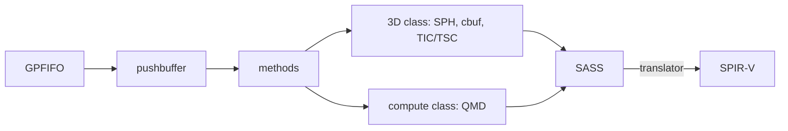

# Glossary

Each term is explained once, here. The architecture pages use them without repeating the explanation.

| term | meaning |
|---|---|
| SASS | NVIDIA's native GPU machine code. On SM86 every instruction is 128 bits, with its scheduling bits inside the word. |
| SM86 | the Ampere instruction set of the GA102 family (RTX 3090, A6000). The Switch 2's T239 uses the same encoding table. |
| T239 | the Switch 2's system-on-chip. Its GPU is the GA10F, an Ampere part. |
| GA102 | the desktop Ampere chip the silicon captures come from. |
| SPIR-V | the binary shader language Vulkan consumes. The translator writes it. |
| spirv-val | the Khronos validator for SPIR-V modules. |
| nvdisasm | NVIDIA's disassembler. It carries the instruction table the decoder is generated from. |
| lavapipe | Mesa's Vulkan driver that runs on the CPU (also called llvmpipe). The CI device. |
| GPFIFO | the ring of 8-byte entries a channel reads. Each entry points at a pushbuffer and gives its length. |
| pushbuffer | a list of 32-bit words in guest memory: method headers followed by their data. |
| method | a register write to a GPU class, addressed by offset. |
| subchannel | one of eight slots a channel binds a class to with SET_OBJECT; each method header names one. |
| class | a GPU engine's register interface: 0xC797 is the Ampere 3D class, 0xC7C0 compute, 0xC76F the channel. |
| MME | the macro engine that expands macro calls into method writes. Ampere uses MME64. |
| QMD | queue meta data: the 256-byte compute launch descriptor in guest memory (grid, block, program, cbufs). |
| SPH | shader program header: the block before a graphics program that names its stage and the attributes it reads and writes. |
| IMAP, OMAP | the SPH's input and output attribute maps. |
| cbuf | constant buffer: a read-only buffer a shader reads with `c[bank][offset]`. Bank 0 carries launch data for compute. |
| TIC | texture image control: a 32-byte texture header in a pool (format, size, layout, address, mips). |
| TSC | texture sampler control: a 32-byte sampler entry in a pool (wrap, filters, LOD). |
| handle | a cbuf word whose low 20 bits index the TIC pool and top 12 bits the TSC pool. |
| block-linear | NVIDIA's tiled texture layout made of GOBs; pitch-linear is plain rows. |
| GOB | group of bytes: 64 bytes by 8 rows, the tile block-linear is built from. |
| warp | 32 threads that run one instruction stream together; a lane is one of them. |
| BSSY, BSYNC | the SM86 pair that marks where diverged lanes of a warp reconverge. |
| HMMA, IMMA | warp-wide matrix multiply-accumulate on tensor cores, for floats and integers. |
| uniform datapath | the per-warp scalar registers UR0 to UR62 and predicates UP0 to UP6. |
| VA, PA | GPU virtual address and guest-physical address. |
| cubin | an ELF file holding compiled CUDA kernels for one SM version. |
| HLE | high-level emulation: implementing a firmware service's behaviour instead of running its code. |
| Unicorn | the CPU emulator library oboromi's ARM cores run on. |

Sources: core/src/gpu/{fifo,threed,texture,engine}.rs, core/src/gpu/compute_class.rs on gpu/qmd-dispatch, NVIDIA's open-gpu-doc class headers.
